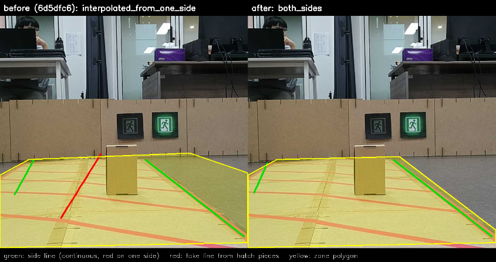
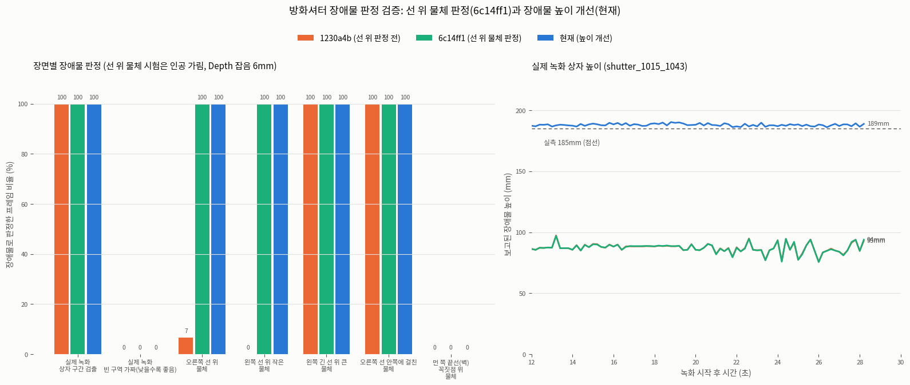
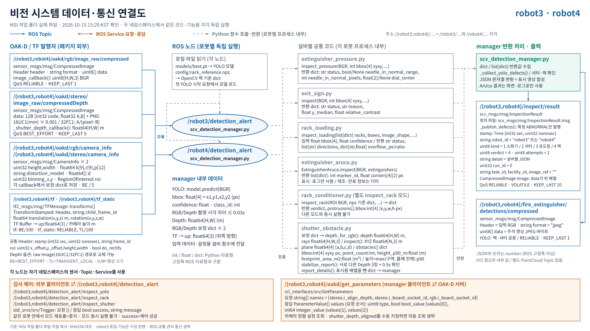

## 오늘 한 일

- MSI에서 푸시한 `feature/vision`의 오늘 커밋을 로컬에 pull 받음. 이전 `8536445`에서 최신 `e961216`까지 반영했으며, 셔터 검출 개선 코드·실행 설명·비교 자료를 읽고 일지로 정리함. 일지 작성 과정에서는 소스 코드를 직접 수정하지 않음.
- `scv_detection_manager.py`가 영상 수신·압축 해제·CameraInfo·TF·ROS 실행을 담당하고, `shutter_obstacle.py`가 구역·바닥·장애물을 계산하는 구조를 유지함. RGB에서 빨간 테이프 검사 구역을 찾고, Depth를 3D 점으로 바꾼 뒤 RANSAC 바닥 평면과 물체 높이를 비교하는 흐름을 확인함.
- 기본 Depth 입력을 손실 없는 PNG `compressedDepth`로 바꾼 내용을 반영함. `16UC1`은 mm에서 m로 변환하고 `32FC1`은 압축 정보로 거리를 복원함. 토픽 이름이 `compressedDepth`로 끝나지 않으면 원본 `Image` 입력을 사용할 수 있음.
- RGB와 Depth의 실제 화면 정렬 및 초점 거리 문제를 보완함. 카메라 설정 변경 뒤 기본 배율·이동 보정은 `1,0,1,0`으로 유지하고, 중앙 잘라내기 영상에 맞춰 기본 초점 거리를 **1036px**로 적용함. 바닥에서 계산한 카메라 높이와 TF 높이를 화면·로그에서 비교하도록 구성함.
- 빨간 선 조각 결합과 구역 추적을 개선함. 현재 검출과 추적 구역이 충분히 겹치면 새 검출을 사용하고, 선이 물체에 가려진 경우와 물체 없이 사라진 경우를 Depth로 구분함. 처음부터 한쪽 선이 가려진 경우에는 보이는 긴 선과 기본 띠 폭 **0.80m**로 구역을 보간함.
- 선 위에 걸친 물체도 장애물 후보에 포함하도록 보완함. 높은 점 자체와 바닥에 내린 발 위치를 화면 구역과 비교하고, 벽이 아닌 경계에는 테이프 폭 정도의 여유를 허용함. 벽 쪽 경계는 별도로 제외해 벽 전체가 물체로 잡히는 문제를 줄임.
- 장애물 판정 범위와 화면 표시 범위를 구분함. 판정·연속 확인은 구역 근처의 `bbox`를 사용하고, 표시는 연결된 물체 전체의 `display_bbox`를 사용함. 보고 높이 `height_p90_m`은 구역 안 높이와 같은 거리대에 이어진 물체 전체의 90백분위 높이 중 큰 값으로 계산함.
- robot3 녹화에서 확인된 세 가지 문제를 보완한 `2161789`와 비교 자료를 추가한 `e961216`을 확인함. **떠 있는 Depth 띠는 아래쪽 지지 여부로 제거**, **벽 쪽 먼 끝 변은 화면 위쪽의 누운 변으로 선택**, **가짜 좌우 선은 이어짐과 양옆 빨간 점 비율로 제외**하도록 변경됨. 물체 면 중간의 빈 Depth 때문에 높이 계산이 끊기는 경우에는 연결 판단용 마스크만 넓히도록 보완함.
- 정지 상태의 셔터 검사에서 영상 짝을 더 잘 선택하도록 최신 기본 시각 차이 허용값을 **0.03초에서 0.10초**, Depth 유효 시간을 **0.5초에서 1.0초**로 변경한 내용을 확인함. 촬영 시각 자체를 덮어쓰는 방식은 사용하지 않으며, 이동 중 검사에는 더 엄격한 시각 기준이 필요함.
- 바닥은 보라색, 바닥 위 물체는 Depth 색으로 구분하고 구역·평면·높이·시각 차이·확인 프레임을 함께 표시함. RANSAC 기본 모드와 별도로 고정 평면을 검증해 사용하는 선택 기능도 유지함.
- robot3·robot4가 같은 기능을 각 네임스페이스에서 독립 실행하는 시스템 연결도를 한 장으로 정리함. 파일·자료형·배열·단위·Topic·Service 이름을 표시한 8K PNG와 편집 가능한 PPTX를 두 일지 폴더에 동일하게 보관함. 발표자료의 지정된 셔터 설명 페이지도 기존 세 칸 형식에 맞춰 정리함.
- 오늘 받은 셔터 검출 사진 3장과 비교 그래프를 두 작성자의 `img`에 같은 이름으로 정리함. 오전에 만든 녹화 GIF는 중간 분석 자료로 보관하고 최신 코드의 실행 결과와 구분함.

### 최신 코드의 주요 기본값

| 항목 | 현재 값과 의미 |
|---|---|
| 입력 | `/{robot3,robot4}/oakd/rgb/image_raw/compressed`, `/{robot3,robot4}/oakd/stereo/image_raw/compressedDepth`, 각 CameraInfo·TF |
| 검사 제어 | `/{robot3,robot4}/detection_alert/inspect_shutter`, `std_srvs/srv/Trigger`로 시작·중지 |
| 바닥 평면 | 기본 `ransac`, 초점 거리 1036px, 바닥 분류 기본 허용값 15mm |
| 시각·신선도 | 정지 검사 기준 RGB·Depth 시각 차이 0.10초 이내, Depth 유효 시간 1.0초 |
| 장애물 후보 | 바닥 위 최소 높이 0.07m, 최소 점 20개, 최소 바닥 투영 면적 0.0004m² |
| 연속 확정 | 같은 구역에서 서로 다른 Depth 최소 3장과 0.5초 이상, 경고 후보 위치도 연속으로 겹쳐야 함 |
| 결과 발행 | `/{robot3,robot4}/inspect/result`, `InspectionResult`의 `kind=2`, `verdict=4`인 확정 불량 이벤트 |

`/{robot3,robot4}/...`는 두 네임스페이스의 별도 경로를 줄인 표기임. 결과 메시지가 없다는 사실만으로 정상이라고 판단하지 않음.

## 시행착오

- 카메라 정렬 파라미터가 확인되고 영상 크기·CameraInfo가 같아도 실제 RGB·Depth 경계가 맞지 않을 수 있었음. 이전 해상도에서 구한 배율·이동값을 새 704×704 영상에 그대로 적용하면 바닥 추정도 실패해, 카메라 설정별로 다시 확인해야 했음.
- CameraInfo의 초점 거리 569.95px를 그대로 사용하면 바닥 높이와 물체 높이가 크게 계산되는 문제가 있었음. 중앙 잘라내기 영상에 맞춘 1036px 보정과 TF 높이 비교로 원인을 구분함. robot3는 바닥에서 계산한 카메라 높이가 TF보다 낮게 나오는 경우가 남아 있어 별도 실측 보정이 필요함.
- robot3에서는 RANSAC이 바닥을 잘 찾았는데도 빗금 테이프 위 얇은 Depth 띠가 7cm를 넘어 장애물로 잡혔음. 바닥 허용값을 더 키우면 실제 낮은 물체까지 지울 수 있어, 바닥 평면 파라미터를 무작정 늘리지 않고 물체 아래쪽의 지지 여부를 검사하는 방식으로 보완함.
- 빗금 조각이 이어진 가짜 긴 선을 좌우 선으로 읽으면서 0.8m 보간 구역이 벽까지 넓어졌음. 선의 길이뿐 아니라 이어짐 비율과 양쪽 빨간 점 분포를 확인해야 했음. 먼 꼭짓점을 바닥 좌표로 바꾸는 과정의 오차도 벽 분류에 영향을 줌.
- 구역 안 물체 부분만 높이로 사용하면 실측 185mm인 robot4 녹화 상자가 약 87mm로 낮게 보고됐음. 물체 전체로 연결해 높이를 계산한 비교 기록에서는 약 188mm로 개선됨. 같은 거리에서 맞닿은 다른 물체가 합쳐질 수 있다는 한계는 남아 있음.
- 한쪽 선 보간은 가려진 구역을 복원하지만 방향 오차 때문에 범위가 넓어질 수 있음. 벽에 붙은 끝선 위 물체, 아래가 빈 탁자 상판, 관측되지 않는 영역까지 모두 해결한 것으로 보지 않음.
- 09:50 사진은 바닥이 검출됐어도 `zone_partial`이라 미확인임. 18:29·18:30 사진은 장애물 경고가 확정됐지만 카메라 높이 비율이 약 0.82·0.84로 표시돼, 검출 성공과 거리·높이의 정확한 보정은 구분해야 함.
- 기존 설명문서 일부 표에는 예전 바닥 허용값·고정 평면값이 남아 있음. 오늘 일지는 실제 코드의 15mm와 최신 기본값을 기준으로 작성했고, 설명문서·그림의 값 정리는 후속 작업으로 남김. 15:29 코드로 만든 연결도의 0.03초 표기도 이후 커밋의 0.10초와 구분함.

## 강조하고 싶은 것 / 달성

- 셔터 검사에서 구역 검출, 바닥 추정, 장애물 후보, 연속 확인, ROS 불량 발행까지의 흐름을 정리함. 바닥이 보인다는 사실과 장애물이 없다고 확정할 수 있다는 판단을 구분함.
- robot3의 벽·빗금 오검출을 바닥 추정 실패와 분리해 원인을 찾았고, 저장된 비교 자료에서 기존 상자 검출을 유지하면서 오검출을 줄인 결과를 확인함.
- 아래 수치는 **MSI에서 작성해 커밋한 녹화 재생·비교 기록**임. 이번 로컬 일지 작성 중 추론·ROS 노드·자동 테스트를 다시 실행하지 않았으며, 제한된 녹화 결과를 전체 환경의 검출률로 일반화하지 않음.

### MSI 비교 기록에서 확인한 결과

| 범위 | 기록된 결과 |
|---|---|
| robot3 녹화 8개, `6d5dfc6` 대비 `2161789` | 상자는 8개 녹화의 모든 프레임에서 유지됨. 비교 자료의 벽 장애물·12cm 미만 작은 거짓 장애물은 수정 후 0프레임 |
| robot3 `1720` | 벽 오검출 74/75 → 0, 작은 거짓 장애물 61/75 → 0, 상자 검출 75/75 유지 |
| robot3 `172302` | 벽 오검출 28/51 → 0, 작은 거짓 장애물 3/51 → 0, 상자 검출 51/51 유지 |
| robot4 녹화 284장 회귀 비교 | 판정은 ABNORMAL 172장·UNCONFIRMED 112장으로 동일, 구역 IoU 중앙값 1.000. 장애물 개수가 바뀐 장은 1장(2개 → 1개, 둘 다 ABNORMAL) |
| robot4 높이 개선 비교의 상자 구간 | 장애물 판정 79/79 유지, 보고 높이 중앙값 약 87 → 188mm. 해당 상자의 실측은 185mm |
| 처리 속도 개선 단계의 녹화 분석 | 한 장 처리 중앙값 460 → 192ms, 최대 413ms로 기록됨. 오늘 최종 커밋 전체의 실시간 처리 속도를 새로 측정한 값은 아님 |

### 오늘 촬영 화면

사진은 각 촬영 시점의 실행 결과임. 18시 사진의 시각 차이 허용값은 0.100초이며, 이 PC에서 최신 커밋을 다시 실행한 결과로 기재하지 않음.

### 시스템 설명 자료와 녹화 정리

- [편집 가능한 시스템 연결도 PPTX](img/2026-10-15-vision-msi-system-diagram.pptx). 15:29 MSI 작업 폴더 수집본을 기준으로 만든 자료이며, 최신 커밋의 시각·신선도 기본값은 위 표를 기준으로 함.
- [오전 녹화 3분할 검토 GIF](video/shutter_1015_1043_review.gif), [바닥 제거 GIF](video/shutter_1015_1043_floor_removed.gif), [바닥 제거 v2 GIF](video/shutter_1015_1043_floor_removed_v2.gif), [바닥·물체 표시 개선 GIF](video/shutter_1015_1043_final.gif), [가림 비교 중간 GIF](video/zone_occlusion_compare.gif)를 두 일지 폴더에 같은 파일로 보관함. 오전에 가져온 버전이므로 파일명에 `final`이 있어도 최신 `e961216`의 재실행 결과를 뜻하지 않음.
- 최신 robot3 비교 녹화는 저장소의 `ros2_ws/src/scv_detection/test/data/robot3_wall_compare.gif`, 분석 조건과 수치는 같은 폴더의 `README.md`를 근거로 함. rosbag 원본은 MSI에 보관된 자료이며 이번 문서 커밋에 추가하지 않음.

## 내일 할 일

- robot3의 실제 카메라 높이와 상자 높이를 재고 초점 거리·Depth 정렬을 따로 보정하기. robot4에서 구한 고정 평면을 robot3에 그대로 적용하지 않기.
- 빈 구역·선 위 물체·벽 근처 물체·처음부터 가려진 선·실제로 지운 선을 나눠 정상·경고·미확인 결과와 재현 조건을 기록하기.
- robot3·robot4 동시 운용에서 네임스페이스별 센서·검사 서비스·불량 이벤트가 섞이지 않는지, 정지 검사에서 최신 시각 기준과 수신 지연이 적절한지 확인하기.
- 최신 커밋으로 셔터·시각 처리 시험을 별도로 실행하고 결과를 남기기. 이번 일지에는 테스트 통과 수를 새로 주장하지 않음.
- 설명문서와 기존 다이어그램의 예전 시각·바닥 허용값·고정 평면 표기를 최신 코드와 맞추기. 확정 불량 이벤트의 관제 수신·알림까지 별도 확인하기.

## 막힌 것 (PM 도움 필요)

- 현재 PM에게 즉시 요청할 사항은 없음. robot3의 실제 높이 보정, 구역 전체가 보이지 않을 때의 정상 확정, 벽과 맞닿은 물체의 구분 및 관제 운영 검증은 후속 확인 사항으로 남김.
