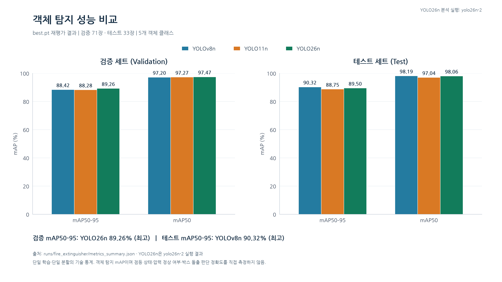
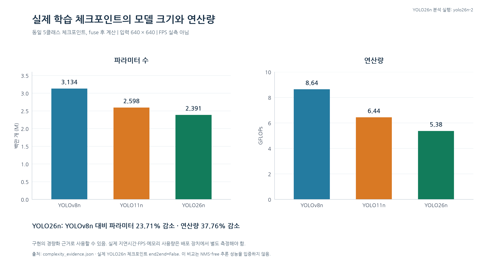
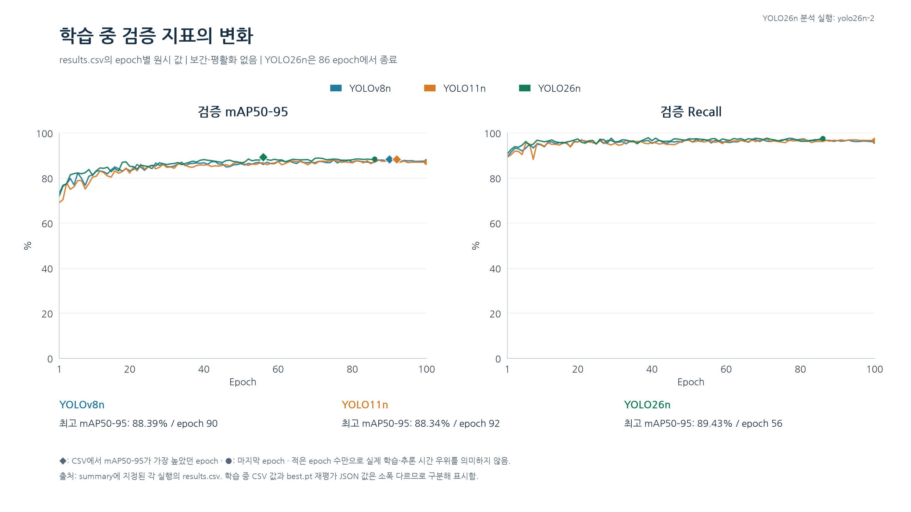
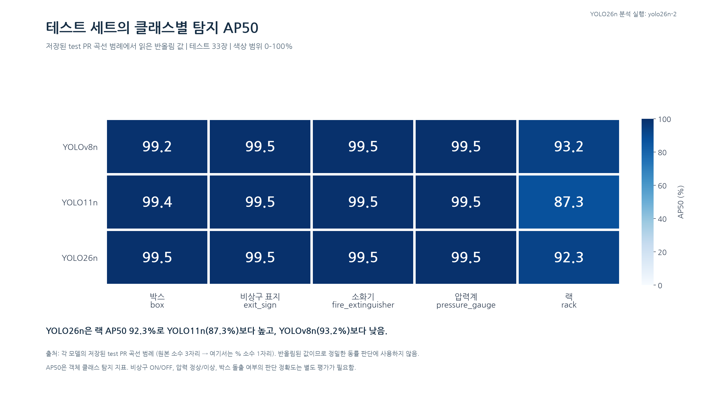

# 물류창고 자율점검 시스템의 YOLO26n 선정 근거

일지 대상 작업: 2026-10-14. 분석 자료 정리: 2026-10-15, Asia/Seoul. **분석 대상은 이번 학습의 `yolov8n`, `yolo11n`, `yolo26n-2` 세 실행이다. 본문·표·그래프의 YOLO26n은 모두 `yolo26n-2/weights/best.pt`와 해당 실행의 결과를 뜻한다.** GitHub 비전 코드와 공유된 SCV 시스템 구성도는 프로젝트 구조와 후속 판정 로직을 설명하는 용도로 사용했다.

**핵심 결론: YOLO26n은 세 후보 중 검증 mAP50–95가 가장 높았고, 테스트에서도 높은 탐지 성능을 확보하면서 추론용 모델의 파라미터와 추정 연산량이 가장 작았다. 따라서 탐지 성능과 계산 자원의 균형을 고려한 선택으로 설명할 수 있다. 테스트 정확도의 절대 우위나 실제 로봇 처리속도 우위까지 입증한 결과는 아니다.**

## 1. 우리 시스템에서 탐지 모델이 하는 일

현재 데이터의 클래스는 `box`, `exit_sign`, `fire_extinguisher`, `pressure_gauge`, `rack` 다섯 가지다. YOLO는 객체 종류와 위치를 찾고, 그 결과를 다음 판정 단계에 전달한다.

| 점검 기능 | YOLO가 찾는 대상 | 이후 판정 로직 | 모델 비교와 연결되는 요구 |
|---|---|---|---|
| 소화기·압력계 점검 | 소화기 본체, 압력계 | 압력계 영역의 정상 색상 구간과 바늘색 등을 검사하고 시간·프레임 조건으로 확인 | 작은 압력계의 검출과 적절한 관심 영역 확보 |
| 비상구 표지 점등 ON/OFF | 비상구 표지 | 표지 영역 밝기, 밝은 면적, 녹색 비율, 주변 대비 등으로 점등 판정 | 표지 누락 방지와 조명 분석 영역 확보 |
| 랙·박스 적재 상태 | 랙, 박스 | 박스의 소속 랙을 연결하고 영상에서 랙 경계를 넘는 방향·정도를 연속 프레임으로 확인 | 랙과 박스의 검출 및 경계 위치 추정 |

소화기 안에서 압력계를 찾지 못하면 소화기 영역을 잘라 같은 모델로 다시 검출하는 경로도 있다. 따라서 모델의 계산량은 전체 점검 처리의 자원 사용과 연결된다. 다만 자원 여유가 실제로 얼마나 생기는지는 로봇에서 별도로 측정해야 한다.

이러한 구조는 세 모델에 공통으로 적용할 수 있다. **다섯 클래스를 한 모델로 처리한다는 사실 자체를 YOLO26n만의 장점으로 주장하지 않고**, 아래 실제 탐지 결과와 모델 규모를 후보 간 선택 근거로 사용한다. [비전 구현 설명](https://github.com/tnduaehowl12/B_0102_Final_Project/blob/2e7e0518cf38672dd8cf13f0eaa7c3713fecf5b8/ros2_ws/src/scv_detection/README.md), [공유 시스템 구성도](https://claude.ai/artifact/DgGKmQnZY4YMkmK53itVNZ).

## 2. 비교 실험 조건과 사용한 실행

| 항목 | 확인한 조건 |
|---|---|
| 비교 모델 | YOLOv8n, YOLO11n, YOLO26n |
| 사용 실행 폴더 | `yolov8n`, `yolo11n`, **`yolo26n-2`** |
| 데이터 | 학습 1,000장 / 검증 71장 / 테스트 33장, 동일 5클래스 |
| 입력·배치 | 640 × 640 / batch 8 |
| 학습 | 최대 100 epoch, patience 30, seed 42, deterministic=True, AMP=True |
| 실제 optimizer | 세 모델 모두 AdamW |
| 라이브러리 | 세 최신 체크포인트 모두 Ultralytics 8.4.177 |
| 평가 | 검증 결과로 저장한 각 `best.pt`를 검증·테스트 분할에 재평가 |

체크포인트의 저장된 학습 설정은 모델 경로와 실행명 외 동일했다. 다만 각 모델은 한 번씩 학습했으므로 반복 실험의 평균·분산을 확인한 비교는 아니다. 학습 1,000장에는 파일명 기준 원본 233장과 증강본 767장이 포함되어 있어 1,000개의 독립적인 촬영 장면으로 해석하지 않는다. 원본 장면 기준의 분할 독립성은 이번 조사에서 검증하지 않았다.

YOLO26n의 학습 곡선은 **`yolo26n-2/results.csv`**, 모델 규모와 추론 모드 확인은 **`yolo26n-2/weights/best.pt`**, 클래스별 PR 곡선은 **`evaluation/yolo26n_test-2/BoxPR_curve.png`**를 기준으로 한다.

수치 출처: [평가 요약 원본](evidence/metrics_summary.json), [실험별 CSV·설정 보존본](evidence/runs), [체크포인트·입력 파일 해시](evidence/input_manifest.json).

## 3. 근거 A — 검증 성능이 가장 높았고 테스트 성능도 높게 유지했다

아래는 학습 중 곡선의 최고점을 가져온 값이 아니라, `metrics_summary.json`에 저장된 **각 best.pt 재평가 결과**다. 단위는 %이며, 모델 간 차이는 퍼센트포인트(%p)로 표시한다.

| 분할 | 모델 | Precision | Recall | mAP50 | mAP50–95 |
|---|---|---:|---:|---:|---:|
| 검증 | YOLOv8n | 98.07 | 96.69 | 97.20 | 88.42 |
| 검증 | YOLO11n | 97.28 | 96.65 | 97.27 | 88.28 |
| 검증 | **YOLO26n** | 97.23 | **97.45** | **97.47** | **89.26** |
| 테스트 | YOLOv8n | **98.21** | 97.14 | **98.19** | **90.32** |
| 테스트 | YOLO11n | 97.14 | **97.69** | 97.04 | 88.75 |
| 테스트 | **YOLO26n** | 97.05 | 97.32 | 98.06 | 89.50 |



YOLO26n의 검증 mAP50–95는 YOLOv8n보다 **0.84%p**, YOLO11n보다 **0.98%p** 높았다. 검증 Recall도 세 모델 중 가장 높았다. mAP50–95는 여러 IoU 기준에서 평가하므로, 객체를 찾는 것뿐 아니라 박스 위치까지 고려하는 점검 시스템의 비교 지표로 유용하다. 다만 평균 mAP 향상이 랙 경계 초과량이나 압력계 바늘 판정 오차의 개선을 직접 뜻하지는 않는다. [평가 지표 설명](https://docs.ultralytics.com/guides/yolo-performance-metrics/).

테스트에서는 YOLOv8n의 mAP50–95가 가장 높았고, YOLO26n은 그보다 **0.81%p 낮았다**. YOLO26n의 테스트 mAP50은 98.06%, mAP50–95는 89.50%였다. 따라서 이 결과는 “YOLO26n이 모든 지표에서 최고”가 아니라, **“검증에서는 우수했고 테스트에서도 비교 후보와 가까운 탐지 성능을 확보했다”**는 근거다. Recall 역시 테스트에서는 YOLO11n이 가장 높다.

## 4. 근거 B — 실제 추론용 모델이 가장 작고 계산량도 적다

학습한 다섯 클래스 체크포인트를 각각 FP32·CPU에서 불러와, 같은 방식으로 `fuse()`한 모델의 파라미터 수와 입력 640 기준 GFLOPs를 계산했다. 체크포인트 파일은 변경하지 않았다. GFLOPs는 Ultralytics/THOP 방식의 추정 산술량이며 지연시간 측정이 아니다.

| 모델 | 추론용 파라미터 수 | 추정 연산량 @640 |
|---|---:|---:|
| YOLOv8n | 3.134M | 8.643 GFLOPs |
| YOLO11n | 2.598M | 6.442 GFLOPs |
| **YOLO26n** | **2.391M** | **5.380 GFLOPs** |



YOLO26n은 YOLOv8n 대비 **파라미터 23.71%, 추정 연산량 37.76%가 적었다**. YOLO11n 대비로는 각각 7.98%, 16.49%가 적었다.

프로젝트 자료는 로봇 PC에서 비전과 Nav2/AMCL 등을 실행하는 구성을 설명한다. 이 구조에서는 객체 검출 외에도 영상 처리와 상태 판정이 필요하므로, 계산량이 적은 모델은 자원 배분 측면의 선택 근거가 된다. 이는 시스템 구조에 대한 설계적 해석이며, 실제 FPS·GPU 메모리·전력·응답시간의 개선 폭을 확인한 것은 아니다. `max_fps=10`도 처리 상한 설정이지 실측 달성 성능이 아니다. [배치 구조](https://github.com/tnduaehowl12/B_0102_Final_Project/blob/2e7e0518cf38672dd8cf13f0eaa7c3713fecf5b8/docs/deliverables/system_design.md), [추론 코드](https://github.com/tnduaehowl12/B_0102_Final_Project/blob/2e7e0518cf38672dd8cf13f0eaa7c3713fecf5b8/ros2_ws/src/scv_detection/scv_detection/scv_detection_manager.py#L1611).

따라서 현재 가장 강한 설명은 **“테스트 mAP50–95에서 v8n 대비 0.81%p 낮은 결과를 보였지만, 계산량은 약 37.8% 적은 모델을 선택했다”**는 성능·계산량의 균형이다. 서로 다른 단위인 %p와 계산량 감소율을 직접 나누어 성능 향상률로 만들지는 않는다.

재현 자료: [CPU 측정 코드](evidence/measure_complexity.py), [환경·모델별 측정값](evidence/complexity_measurement.json).

## 5. 근거 C — 이번 학습에서 더 적은 epoch에 최고 검증값에 도달했다



| 모델 | CSV상 최고 검증 mAP50–95 | 최고 epoch | 종료 epoch | CSV 누적 학습시간 |
|---|---:|---:|---:|---:|
| YOLOv8n | 88.39% | 90 | 100 | 568.2초 |
| YOLO11n | 88.34% | 92 | 100 | 587.6초 |
| YOLO26n | 89.43% | **56** | 86 | 613.9초 |

이번 실행에서 YOLO26n은 56 epoch에 최고 검증값을 기록했고, 이후 patience 30 조건에 따라 86 epoch에 종료됐다. YOLOv8n과 YOLO11n의 최고 epoch는 각각 90과 92였다. 따라서 **“이번 실험에서는 더 적은 epoch에 최고 검증 성능에 도달했다”**고 설명할 수 있다.

반면 총 기록 학습시간은 YOLO26n이 가장 길었다. “가장 빨리 학습했다” 또는 “추론도 가장 빠르다”는 설명은 이 곡선으로 뒷받침되지 않는다. 또 YOLOv8n·YOLO11n의 DFL loss와 YOLO26n의 L1 loss는 정의가 달라, loss 절댓값으로 세 모델의 정확도 순위를 정하지 않는다.

CSV 최고값과 3절의 JSON 재평가 값은 서로 다른 평가 시점의 기록이다. 예를 들어 YOLO26n은 각각 89.43%와 89.26%이므로, 발표에서 하나의 값인 것처럼 섞지 않는다.

## 6. 클래스별 결과와 점검 기능에 대한 해석

아래 AP50은 저장된 테스트 PR 곡선 범례의 소수 셋째 자리 값을 읽어 %로 옮긴 **반올림 값**이다.

| 모델 | 박스 | 비상구 표지 | 소화기 | 압력계 | 랙 |
|---|---:|---:|---:|---:|---:|
| YOLOv8n | 99.2 | 99.5 | 99.5 | 99.5 | 93.2 |
| YOLO11n | 99.4 | 99.5 | 99.5 | 99.5 | 87.3 |
| YOLO26n | 99.5 | 99.5 | 99.5 | 99.5 | 92.3 |



소화기·압력계·비상구 표지는 세 모델 모두 AP50이 높아, 해당 수치만으로 YOLO26n의 독보적인 우위를 주장하기 어렵다. 랙은 YOLO26n이 YOLO11n보다 높고 YOLOv8n보다 낮다. **랙 검출이 비교적 어려운 클래스이며 추가 점검할 대상**이라는 해석이 적절하다. PR 범례가 반올림되어 있으므로 표시값이 같다는 이유로 정확히 동일한 성능이라고 단정하지 않는다.

테스트는 33장·90개 객체이고, 클래스별 객체 수는 박스 41개, 비상구 표지 9개, 소화기 11개, 압력계 11개, 랙 18개다. 특히 비상구 표지가 포함된 이미지는 5장이다. 이 표본으로 모든 물류창고·조명·가림 조건에 대한 우위를 일반화할 수는 없다.

현재 mAP가 검증하는 범위는 **객체 검출·위치 추정**이다. 다음은 별도의 정답 데이터로 평가해야 한다.

- 비상구 ON/OFF 판정: 점등·소등 사례별 판정 정답률, 소등을 정상으로 판단한 비율.
- 압력계 판정: 정상·이상 바늘 위치별 혼동행렬, 미확인 비율. 현재 구현은 실제 압력 단위를 읽는 계측 모델이 아니다.
- 적재 상태 판정: 정상·경계 초과 사례별 오탐·미탐, 촬영 각도·거리별 결과. 현재 랙·박스 로직은 영상의 2차원 경계 초과 판단이며 실제 앞뒤 방향 돌출 거리를 직접 계측하지 않는다.
- 실제 로봇 성능: 동일 영상·장치·입력 설정의 처리 지연시간과 FPS, 전체 점검 요청부터 판정까지의 시간.

위 항목은 이번 세 체크포인트 비교의 후속 확인 사항이며, 이 보고서를 만들면서 새 학습이나 배포를 수행하지는 않았다.

## 7. 발표에 그대로 사용할 문장

### 설명 문단

> 물류창고 자율점검 시스템은 소화기와 압력계, 비상구 표지, 랙과 박스를 검출한 뒤 별도 로직으로 설비 상태를 판단합니다. 이번에 동일한 데이터 분할과 학습 설정으로 학습한 YOLOv8n·YOLO11n·YOLO26n을 비교했으며, YOLO26n 결과는 yolo26n-2 실행을 기준으로 했습니다. YOLO26n은 검증 mAP50–95 89.26%로 세 후보 중 가장 높았고, 테스트에서도 mAP50 98.06%, mAP50–95 89.50%를 기록했습니다. 테스트 mAP50–95는 YOLOv8n이 0.81%p 높았지만, YOLO26n은 추론용 파라미터가 약 23.7%, 추정 연산량이 약 37.8% 적었습니다. 이 결과는 탐지 성능과 계산 자원의 균형을 고려한 YOLO26n 선정 근거입니다.

### 한 장에 넣을 요점

**슬라이드 제목:** 객체 탐지 성능과 계산량의 균형을 고려한 YOLO26n 선택

- 이번 학습의 동일 조건 비교: YOLOv8n / YOLO11n / YOLO26n (`yolo26n-2`).
- 검증 mAP50–95 **89.26%로 최고**, 테스트 mAP50–95 **89.50%**.
- YOLOv8n 대비 추론용 파라미터 **23.71%**, 추정 연산량 **37.76% 감소**.
- 테스트 mAP50–95는 YOLOv8n이 **0.81%p 우세**하다는 점을 함께 제시.
- 객체 탐지 결과를 점등·압력계·적재 상태 판정 로직의 입력으로 사용.

하단 각주 예시: “동일 데이터·설정의 단일 실행 비교. GFLOPs는 fuse 후 640 입력 기준 추정값. 최종 상태판정 정확도와 실측 FPS는 별도 평가 대상.”

### 예상 질문과 답변

**Q. 테스트 결과는 v8n이 더 높은데 26n의 선정 근거는 무엇인가요?**

테스트 mAP50–95만 보면 v8n이 0.81%p 높습니다. 다만 26n은 검증 지표가 가장 높았고, 테스트에서도 높은 탐지 성능을 보이면서 추정 연산량이 약 37.8% 작았습니다. 따라서 계산 자원을 함께 고려한 선택입니다. 실제 로봇에서 어느 모델이 더 빠른지는 동일 조건의 지연시간 측정이 필요합니다.

**Q. 비상구 ON/OFF나 압력 상태가 99.5% 정확하다는 뜻인가요?**

99.5%는 PR 곡선에 표시된 객체 탐지 AP50입니다. 점등이나 바늘 상태는 검출 영역을 이용한 후속 로직이 판단하므로, 그 기능의 판정 정확도는 별도 데이터로 평가해야 합니다.

**Q. YOLO26n은 NMS-free라서 더 빠른가요?**

YOLO26은 해당 추론 경로를 지원하지만, 이번 `yolo26n-2/weights/best.pt`의 실제 head 설정은 `end2end=False`였습니다. 따라서 현재 결과에 NMS-free의 실측 이점을 붙이지 않았고, 확인한 모델 크기와 산술량을 근거로 사용했습니다. [YOLO26 공식 설명](https://docs.ultralytics.com/models/yolo26/).

## 8. 자료를 사용할 때 구분할 사항

1. **분석 대상 고정:** YOLO26n의 수치·곡선·모델 규모는 `runs/fire_extinguisher/yolo26n-2`를 기준으로 한다. 그림 생성 코드에서도 실행 폴더와 체크포인트 경로를 확인한다.
2. **NMS-free:** 이번 `yolo26n-2/weights/best.pt`의 실제 설정은 `end2end=False`다. 지원 기능과 이번 평가에 사용한 모드를 구분한다.
3. **학습 optimizer:** 이번 실제 optimizer는 AdamW다. 공식 문서에 소개된 MuSGD를 이번 비교 실험의 사용 설정으로 적지 않는다.
4. **실측 속도:** GFLOPs가 적다고 동일 비율로 FPS가 늘거나 응답시간이 줄었다고 쓰지 않는다. 공식 COCO·CPU·TensorRT 결과도 우리 커스텀 데이터·로봇 결과와 구분한다.
5. **통계 범위:** 단일 seed·작은 테스트 분할이므로 통계적 유의성이나 모든 현장 조건의 우위를 입증했다고 쓰지 않는다.

## 9. 확인한 출처와 재현 자료

- [로컬 평가 요약](evidence/metrics_summary.json): best.pt 검증·테스트 정량 지표.
- [학습 지표 감사 기록](evidence/metrics_audit.md): 학습 조건, 최고 epoch, 클래스 개수, 체크포인트 설정 확인.
- [GitHub 조사 기록](evidence/project_evidence.md): 프로젝트 구조와 후속 판정 로직 확인.
- [GitHub 비전 코드 고정 커밋](https://github.com/tnduaehowl12/B_0102_Final_Project/tree/2e7e0518cf38672dd8cf13f0eaa7c3713fecf5b8/ros2_ws/src/scv_detection): 실제 탐지와 후속 판정 로직.
- [Claude 공유 구성도](https://claude.ai/artifact/DgGKmQnZY4YMkmK53itVNZ): SCV V6.7 시스템 흐름과 설계·구현 상태 설명. 구성도는 설계 자료이며 실제 코드와 차이가 표시되어 있다.
- [Ultralytics YOLO26](https://docs.ultralytics.com/models/yolo26/), [평가 지표 설명](https://docs.ultralytics.com/guides/yolo-performance-metrics/): 모델 구조·추론 모드·지표 해석의 보조 자료. 공식 벤치마크 값을 우리 데이터의 실험값으로 대체하지 않았다.
- 제공된 [Notion AMR 페이지](https://app.notion.com/p/AMR-3f26e197bd8b801388b3d74cd2248810)는 연결 계정에서 404, 브라우저에서는 로그인 요구가 표시되어 본문을 열람하지 못했다. 읽지 못한 내용을 결론의 근거로 사용하지 않았다.
- [그림 생성 코드](plot_comparison.py): 보존된 JSON·CSV와 모델 규모 측정값에서 PNG·SVG 4종 생성. 재학습이나 이미지 추론을 실행하지 않는다.

이 문서와 같은 분석 자료 폴더에서 그림 재생성:

```bash
python3 plot_comparison.py
```
