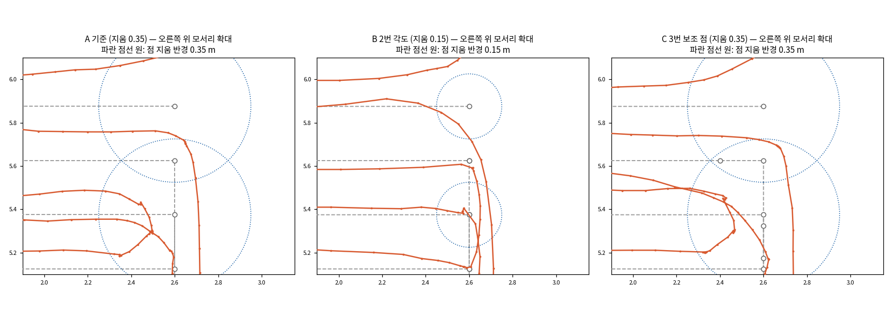
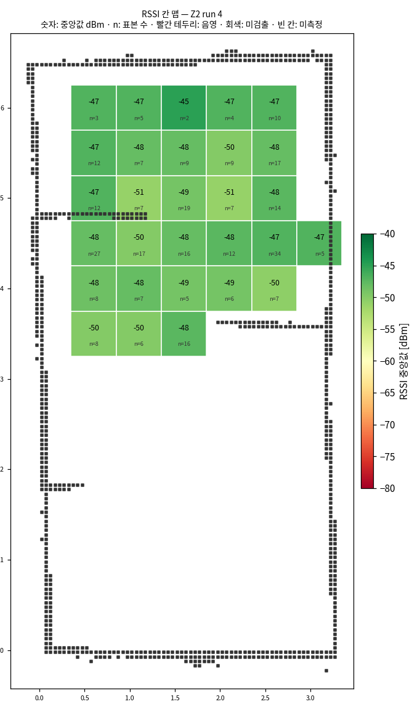

## 오늘 한 일
### 주행 (T5)
- `navigate_through_poses_scv.xml` 의 `RemovePassedGoals radius` 0.35 → 0.15 (관제 모서리 처리 비교 시험 근거, `docs/driving/NAV2_PARAMS.md` 에 기록)
  - 관제가 RPP(lookahead 0.4)가 지울 만큼 다가가지 못할 모서리를 작업 끝점으로 보내므로(`corner_mode=angle`) 작게 해도 점이 안 지워지는 일이 없음. 두 값은 같이 바꿈

### 관제 (T6)
- 측정 경로를 칸 기준으로 다시 짬 (0e6bb3e): RSSI 칸마다 방문 점 → 직선으로 갈 수 있는 이웃만 연결 → Dock 에서 이어진 칸만 → 가로로 이어진 칸을 줄로 묶음 → 직선이 벽에 걸리거나 되돌아가는 점에서 작업을 나눔
  - 10/13 밤 5번 점(벽 조각 아래 막다른 자리)에서 멈추던 것이 풀림. 지도가 바뀌어도(줄을 가로지르는 벽, 닫힌 방) 같은 규칙으로 경로가 나오는 것을 시험으로 고정
- robot3 한 대로 처음 완주 (run 3, 11:20): 측정 12점 → Dock → 칸 확정 Z2 28칸 → Dock → 종료, 4분 29초, 건너뛴 점 0
- 재측정 대상에서 미측정 칸을 뺌 (`include_unmeasured` 기본 false): 문서의 재측정은 음영 · 미검출 후보의 30초 정밀 측정. run 3 은 전 칸 정상인데 미측정 칸 하나에 30초 측정 + Dock 왕복이 돌았음
- 칸 맵 히트맵 스크립트 `scv_manager/scripts/cellmap_heatmap.py` (8e138a5)
- 측정 줄 간격 0.25 m · 한 줄 건너 돌기 (4b7a284): 칸 한 줄을 1/4 · 3/4 높이로 두 번 지나고, U턴 폭은 0.5 m 그대로
  - run 4 (12:02): 측정 4분 26초(0.5 m 때 2분 13초), 칸 29 전부 정상, 칸당 표본 수 중앙값 4 → 8, 표본 0개이던 칸 (4,10) 0 → 7
- 모서리 처리 비교 시험 (a923226, `docs/control/PLAN.md` N-10) — robot3 · Z2 · 0.25 m 간격, 궤적은 bag(`/robot3/amcl_pose`) · RSSI 샘플 위치로 비교

| 회차 | 방식 | 모서리에 가장 가까이 간 거리 최대 | 줄 가운데 계획 줄과의 거리 중앙값 | 측정 시간 |
| --- | --- | --- | --- | --- |
| A (run 5) | 기준, 지움 0.35 | 0.32 m | 0.135 m | 4분 47초 |
| B (run 6) | 못 지울 모서리를 작업 끝점으로, 지움 0.15 | **0.10 m** | **0.048 m** | 6분 13초 |
| C (run 7) | 모서리 뒤 0.2 m 보조 점, 지움 0.35 | 0.25 m | 0.092 m | 4분 39초 |

  - B 채택: 모서리 · 직선 모두 정확도가 뚜렷이 좋음. 늘어난 86.5초 = 작업 사이 대기 +13초(작업 8 → 24개) + 모서리 정지 · 정렬 +73초. C 는 효과가 없어 코드에서 지움

## 시행착오
<!-- 줄 앞에 어느 업무인지 적어요: [주행] … / [관제] … -->
- [관제] run 3 에서 줄이 지나간 칸 (4,10) 에 표본이 0개: 벽 조각을 피해 올린 줄(y 5.15)이 칸 경계에서 0.10 m 이고 바로 앞이 회전 구간이라, RPP 회전 오프셋으로 윗줄 칸에 찍힌 것으로 봄 → 칸마다 두 줄(0.25 m)
- [관제] 0.25 m 간격으로 바로 옆줄로 꺾으면 U턴 폭이 점 지움 반경(0.35)보다 좁아 두 점이 함께 지워짐 → 한 줄 건너 돌기 + 다음 점이 지움 반경 안이면 그 점을 혼자 한 작업으로
- [관제] 줄 이탈을 처음에 「줄에서 0.125 m 안의 점」만으로 재서 A 를 0.08 m 로 작게 봄. 궤적을 그려 보니 두 줄 사이를 달리는 곳이 있었음 → 궤적 점을 경로 구간 순서대로 짝지어 다시 잼 (A 0.135 m)
- [관제] B 회차 bag 이 0 바이트: 기록 탭을 Ctrl+C 없이 바로 닫음 → RSSI 샘플 CSV(1 Hz)의 위치로 대신 비교. C 부터는 Ctrl+C → 「Recording stopped」 확인 뒤 닫음
- [주행] B 회차 마지막 Dock 이 `DOCK_FAILED`: Dock 앞 지점까지는 갔고 Create3 도킹 단계에서 8초 만에 실패. 원인 미확인, 한 번만 남. 손으로 dock 해서 이어 감
- [관제] RViz 의 global costmap 이 하얗게 보임: 투명도 0.3 으로 지도 위에 덮는 설정 때문 (자료는 정상, 0.7 Hz). Downsampled Costmap 경고는 NavFn 이 그 토픽을 내지 않아서
- [관제] RViz 실시간 히트맵(`/survey/heatmap`)은 회차를 시작해도 비워지지 않음 → `ros2 service call /network_map_engine/reset_survey std_srvs/srv/Trigger`

## 강조하고 싶은 것 / 달성
<!-- 이 줄은 노션에 안 나가요. 그림:   이름에 빈칸이 있으면 
     영상: video: video/YYYY-MM-DD_이름.mp4 설명   YouTube: video: https://youtu.be/… 설명 -->
- 새 측정 경로로 robot3 완주 4회 (run 3 · 4 · 5 · 7, run 6 은 Dock 만 실패). 칸 맵 29칸 모두 정상, 표본 0개인 칸 없음
- 모서리 처리 비교: 계획 경로(회색 점선)와 실제 궤적(주황). B 는 모든 모서리를 0.10 m 안으로 찍음

- 줄 간격 0.25 m 회차(run 4)의 RSSI 칸 맵

## 내일 할 일
### 주행 (T5)
- 지움 반경 0.15 로 다른 주행 시험(course_run 등)에 영향이 없는지 확인
- B 회차 Dock 실패 재현 확인 (같은 조건으로 몇 회)

### 관제 (T6)
- 새 기본값(`corner_mode` angle · 지움 0.15)으로 관제 · 로봇 PC 를 다시 띄워 한 회차
- 핫스팟을 끈 채 음영 · 미검출 → 재측정(30초 정밀) → 회피 마스크 → 마스크 주행 (2-6 · 2-7)
- robot4(Z1, 설비 포함)로 완주, 이어서 두 대 동시
- 작업 사이 대기 줄이기 (작업이 끝나면 배정 타이머 0.5초를 기다리지 않고 바로 다음 작업)

## 막힌 것 (PM 도움 필요)
- 없음
