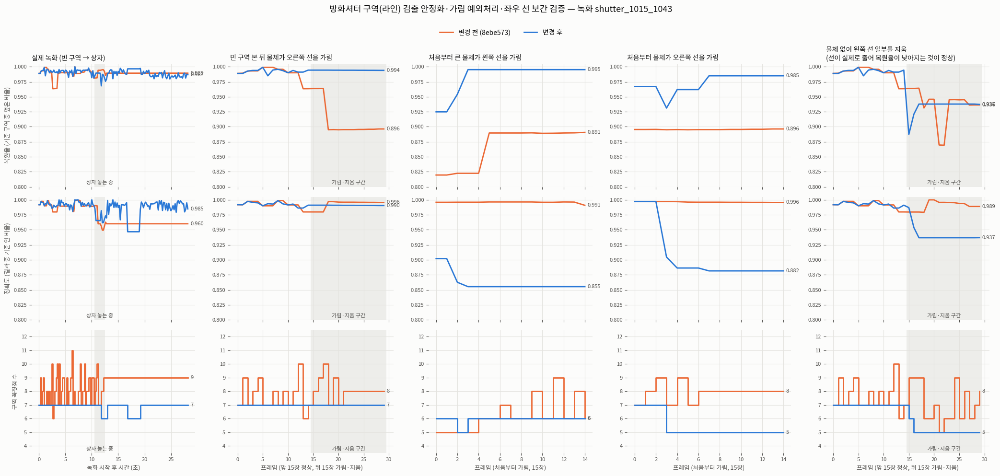
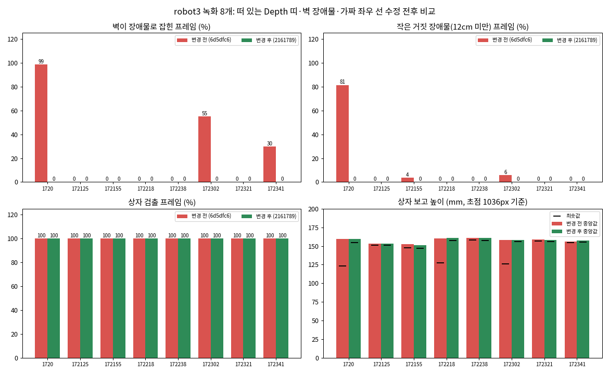
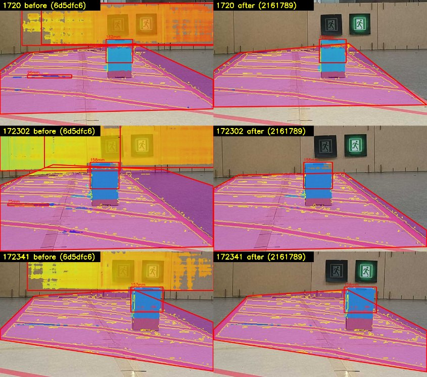
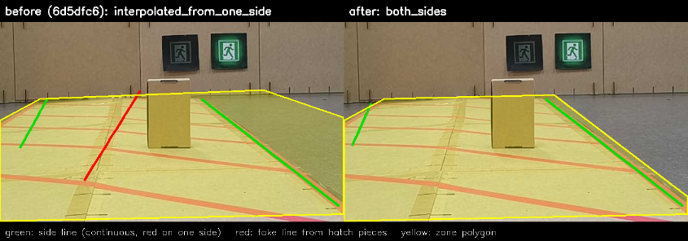

## 오늘 한 일
### 비전 (T4) — 방화셔터 장애물 검사 (feature/vision, 커밋 98ce70a ~ e961216)
- robot4 rosbag 녹화(`shutter_1015_1018`, `shutter_1015_1043`)로 RGB · Depth 정렬 확인 → 카메라 설정 변경(RGB 704×704, RGB · Depth 모두 10 Hz, 위상차 0.08 ms) 뒤 배율 보정 없이 1:1 정렬
- 초점 거리 보정 (8ebe573): CameraInfo 569.95 px 로는 높이가 약 1.8배 크게 나옴 → `shutter_focal_length_px` 1036 px 로 덮어씀
  - 바닥 평면 카메라 높이 0.237 m (TF 0.244 m), 상자 높이를 재는 화면 · 로그 「카메라 높이 확인」 추가
- 바닥 제거: Depth 를 compressedDepth(PNG, 손실 없음)로 받고, 바닥보다 아래로 잰 스테레오 오차도 바닥으로 지움, 바닥 허용 15 mm
- 처리 속도: 한 장 약 460 ms → 190 ms (결과 동일, 세로 중앙값 필터 · RANSAC 점수 계산을 한 번에)
- 결과 화면: 빨간 선 안 바닥은 보라색, 바닥 위 물체만 Depth 색으로 표시
- 구역(라인) 검출 안정화 · 가림 예외처리 (1230a4b)
  - 새 검출이 추적 결과와 IoU 0.95 이상이면 새 검출을 써서 옛 모양에 굳지 않게 함 (정확도 0.960 → 0.991, 꼭짓점 6~11 → 6~7개)
  - 물체가 선을 가리면 '보임 / 물체에 가려짐'으로 설명될 때 기억한 구역 유지 (복원율 0.964 → 0.994)
  - 한쪽 선만 보이면 띠 폭 0.80 m(실측) 평행선으로 반대쪽을 채움 (처음부터 가린 시험 복원율 0.89 → 0.99)
- 선 위에 선 물체도 장애물로 판정 (6c14ff1): 화면 좌표로 판정, 벽에 붙은 끝선만 안쪽 띠를 뺌 → 선 위 물체 0~1/15 → 15/15
- 장애물 높이를 물체 전체 기준으로 (6d5dfc6): 상자(실측 185 mm) 보고 높이 87 mm → 188 mm
- robot3 녹화 8개(`robot3_shutter_1015_*`)로 다시 점검 (2161789)
  - RANSAC 바닥 평면은 모든 프레임 정상(일치 0.93~0.98, 잡음 4~9 mm) → 파라미터 그대로
  - 빗금 테이프 위 떠 있는 Depth 띠 제거: 높은 점 아래(발 쪽)가 절반 넘게 바닥이면 장애물에서 뺌
  - 벽 장애물 수정: 띠 끝(벽 쪽) 변을 화면에서 가장 위에 있고 30° 이하로 누운 변으로 고름
  - 가짜 좌우 선 제거: 끊김 없이 이어지고(10 cm 칸 70 % 이상) 양옆 중 한쪽에만 빨간 점이 있는 선만 씀
  - RGB · Depth 시각 허용 0.03 → 0.10초 (정지 상태에서 검사하므로)
- 검증 자료 · README (`test/data/`, e961216 포함): rosbag 검토 · 바닥 제거 · 최종 검출 GIF, 구역 · 장애물 · robot3 수정 전후 비교 그래프
- 셔터 테스트 29개 통과 (가짜 선 · 먼 끝 변 · 떠 있는 띠 시험 추가)

### 주행 (T5)
- 오늘은 비전(T4) 작업만 진행

### 관제 (T6)
- 오늘은 비전(T4) 작업만 진행

## 시행착오
<!-- 줄 앞에 어느 업무인지 적어요: [주행] … / [관제] … -->
- [비전] 바닥 표시가 깜빡임: RGB 마다 짝이 없는 화면을 그리고, 계산하는 동안 0.5초 기준이 지나 결과를 지웠음 → 최신 짝 우선 선택, 신선도는 짝을 고를 때만 확인, 짝이 없으면 마지막 화면 유지
- [비전] 높이가 실제의 약 1.8배 → CameraInfo 초점 거리(569.95 px)가 ISP · 자르기 설정과 맞지 않음. 상자 185 mm · TF 카메라 높이로 1036 px 를 잼
- [비전] 구역 추적이 옛 모양에 굳고 꼭짓점이 계속 늘어남 → 새 검출과 맞으면 새 검출 사용, 다각형 단순화
- [비전] 선 위 물체를 바닥 좌표로 판정하니 먼 쪽 꼭짓점이 2.9~3.2 m 로 밀려(실제 벽 2.6 m) 벽 전체가 구역 안 물체가 됨 → 화면 좌표로 판정
- [비전] 인공 가림 시험에서 물체 Depth 잡음을 0으로 넣었더니 바닥 발자국 면적이 0이라 빠짐 → 카메라 수준 잡음(6 mm)을 넣음
- [비전] robot3: 가로 빗금 테이프에서 스테레오가 짝을 잘못 찾아 바닥 위 4~10 cm 띠가 생김 → 1720 녹화 75장 중 61장에 거짓 장애물. 분류 거리를 키우면 7 cm 장애물 기준을 넘어 쓸 수 없어 '아래쪽 지지 확인'으로 해결
- [비전] robot3: 먼 끝 변을 바닥 좌표 → 화면 방향 → 국소 바닥 방향 순서로 시험했으나, 꼭짓점이 벽 위 · 지평선 근처에 걸리면 모두 틀림 → 바닥 좌표를 쓰지 않고 화면 위치 · 기울기로 고름
- [비전] robot3: 여러 빗금 조각이 앞쪽 방향 가짜 긴 선으로 이어져 한쪽 보간이 구역을 벽까지 넓힘 → 선의 이어짐 · 양옆 빨간 점으로 가짜 선 제거
- [비전] robot3 상자 높이가 가끔 124~134 mm 로 낮게 나옴: 상자 면 가운데 빈 Depth 줄에서 물체 확장이 끊김 → 이어짐 판단만 위아래 5줄 넓혀 해결 (155~163 mm)

## 강조하고 싶은 것 / 달성
<!-- 이 줄은 노션에 안 나가요. 그림:   이름에 빈칸이 있으면 
     영상: video: video/YYYY-MM-DD_이름.mp4 설명   YouTube: video: https://youtu.be/… 설명 -->
- robot4 녹화: 빈 구역 가짜 장애물 0/53, 상자 79/79 검출, 상자 높이 188 mm (실측 185 mm)
- robot3 녹화 8개: 벽 장애물 1720 74/75 → 0, 172302 28/51 → 0, 172341 16/54 → 0. 작은 거짓 장애물 0, 상자는 모든 프레임에서 검출
- robot4 녹화 284장은 수정 전후 판정이 모두 같음 (기존 성능 유지)
- 구역(라인) 검출 안정화 · 가림 예외처리 전후 비교 (복원율 · 정확도 · 꼭짓점 수)

- 선 위 물체 판정과 장애물 높이 개선 (선 위 물체 0~1/15 → 15/15, 높이 87 → 188 mm)

- robot3 녹화 8개 수정 전후: 벽 장애물 · 작은 거짓 장애물 · 상자 검출 · 상자 높이

- robot3 결과 화면: 왼쪽 수정 전(벽 전체 · 빗금 테이프 띠가 장애물), 오른쪽 수정 후(상자만)

- 빗금 조각이 이어진 가짜 좌우 선(빨강) 때문에 구역이 오른쪽 바닥까지 넘치던 것 → 실제 선(초록)만 사용

## 내일 할 일
### 비전 (T4)
- robot3 초점 거리 맞추기: 상자 실제 높이를 재고 「카메라 높이 확인」과 함께 비교 (지금 robot3 은 상자 약 160 mm, 카메라 높이 218~237 mm 로 TF 244 mm 보다 작게 나옴)
- robot3 빈 구역 녹화로 정상(NORMAL) 판정 확인
- 실기에서 셔터 검사 서비스(`~/inspect_shutter`)로 한 번에 돌려 보기

### 주행 (T5)
- 없음

### 관제 (T6)
- 없음

## 막힌 것 (PM 도움 필요)
- 없음
