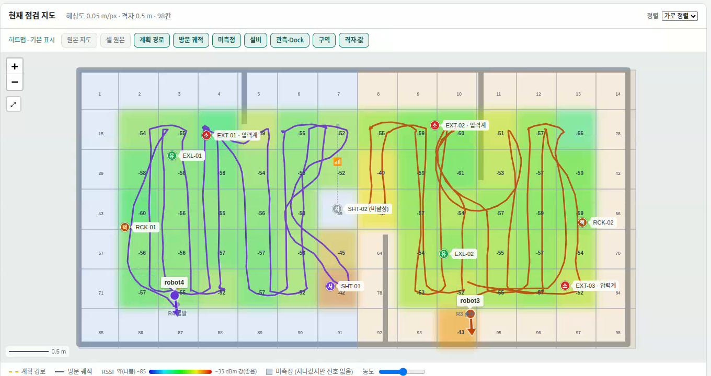

## 오늘 한 일
- 통합 브랜치 `temp/integration-1014` 로 주행 + RSSI + 관제 실기 검증 (robot3 단독 1~3회차 → 두 대 4회차 이후). 회차마다 드러난 문제를 바로 고쳐 46개 커밋 (도킹 검사 · 표본 run_id · 재개 시 남은 점만 · 비상정지 기록 · 배터리 교착 · 장애물 회피 40초 · 순찰 종료 버튼 등)
- 오후 네트워크 단절 원인 두 가지를 확정하고 해결: robot4 Pi 가 죽은 관제 구독자 9개로 계속 보내던 것(Pi 재부팅 546 → 14 KB/s), RSSI 전체 대역 스캔이 무선랜을 채널 밖으로 끌고 나가던 것(채널 고정 · 핫스팟만 묻는 probe → ping 4000 ms 대 → 3.7 ms, bringup 중단 11회 → 0회)
- 비전 통합 (비전 팀 추가 작업 없이 우리가 빈틈을 메움): 점검 요청 IF-05 를 액션 → 서비스로 바꾸고, 비전 노드에 `inspect_facility` 서비스를 붙여 설비 종류별 검사 → 판정 · 근거 사진을 관제에 보냄
- RSSI 팀 재점검 수정(미검출 보존 · 판정 · 저장 순서)을 검토해 통합. PM 결정 반영: 판정은 1차 · 재측정 모두 중앙값, 재측정은 1차 미검출 칸만, 저장 실패에도 순찰 계속
- 설비 실측 좌표 8곳(쿼터니언 → yaw)을 넣고 섹터 담당 로봇이 점검하도록 확인 (Z1 robot4: 셔터 · 랙 · 소화기 · 유도등, Z2 robot3: 소화기 2 · 랙 · 유도등)
- 관제 웹: 로봇 카드에 설비 점검 결과 팝업(사진 · 판정 · 소화기 ArUco 제조 정보), 주행 카메라는 블랙박스로 저장해 이력 탭에서 재생
- 비전 팀 PC 를 robot4 로봇 PC 로 전환 (빌드 · 실행 스크립트 · iw 설치), 세 PC 를 원격 세션과 함께 같은 버전으로 맞춤
- 최종 순찰 촬영 (관제 웹 · 로봇 PC 화면 녹화), 웹 클로드 전달 문서 작성

## 시행착오
- 도크 위에서 라이다만 켜고 Nav2 를 띄우는 방식을 시도했지만 start_motor 뒤 라이다 드라이버가 4번 죽어 기본은 켤 때 undock 으로 되돌림
- 문제를 풀려고 Discovery Server 를 재시작할수록 죽은 구독자가 쌓여 오히려 악화 → 재시작하지 않고 로봇 Pi 재부팅으로 정리하는 규칙으로 바꿈
- app · db 폴더를 src 안으로 옮긴 뒤 웹 서버가 설정 파일을 `src/src` 에서 찾는 버그를 로봇 없는 시험에서 발견해 실기 전에 고침
- 실시간 카메라는 화질 · 끊김 때문에 빼고, 블랙박스(이력 재생) + 점검 결과 팝업으로 바꿈
- iPhone 핫스팟 「호환성 최대화」가 켜지면 2.4 GHz 로 바뀌어 5 GHz 고정 측정에서 안 잡힘. 다시 켤 때마다 BSSID 도 바뀌어 집계는 SSID · 시간 구간 기준으로 해야 함 → 최종 시험은 고유 이름 핫스팟(KDY-Zfold8, 2.4 GHz)으로

## 강조하고 싶은 것 / 달성
<!-- 이 줄은 노션에 안 나가요. 그림:   이름에 빈칸이 있으면 
     영상: video: video/YYYY-MM-DD_이름.mp4 설명   YouTube: video: https://youtu.be/… 설명 -->
- 두 대가 섹터를 나눠 RSSI 측정 → 설비 점검 → 도킹까지 한 바퀴를 실제 좌표로 완주 (run 10: 9분 49초, 설비 8곳 모두 기록 · 실제 비전 판정 3건 이상 검출)
- 측정 표본 1064건 검출 / 45건 미검출, 칸 통계 60칸이 관제 DB 에 쌓이고 웹 히트맵으로 바로 확인

## 내일 할 일
- 최종 발표 · 시연, 산출물 제출 (영상 · 발표자료 · 소스코드 zip · 시스템 설계도 · Design Doc · 통신 계약 문서)
- 통합 브랜치를 main 에 반영 (팀 확인 뒤)
- 남은 과제 정리: 랙 기준 사진 다시 저장, 도킹 뒤 경로 계획 오류 로그 원인, 대체 관측 자리 실기 확인

## 막힌 것 (PM 도움 필요)
- 없음
