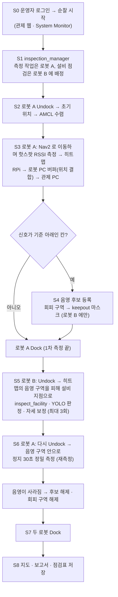
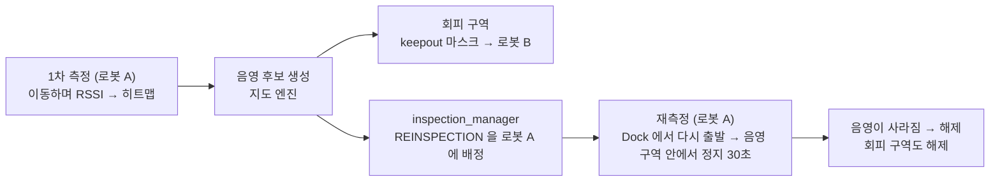
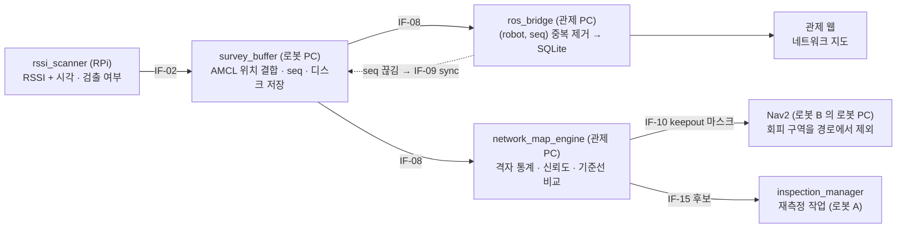
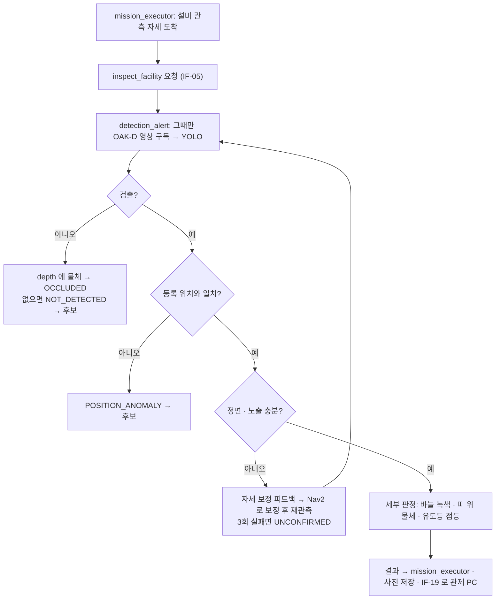

# SCV Process Flow (제출용 초안 v0.1)

> 이 저장소 문서가 원본이다 (10/11 PM 결정). 노션 「SCV 설계」는 10/10 까지의 예전 판이다.
>
> 10/12 PM 결정(시나리오 변경 — 이 문서의 10/11 내용 중 「A → B → A」·「로봇 A 는 측정만, 로봇 B 는 점검만」·「번갈아 구동」보다 이 문단이 우선한다): 두 로봇이 동시에 주행한다. 구역을 섹터 2개로 나눠 로봇 A(`/robot4`)·로봇 B(`/robot3`)가 하나씩 맡고 같은 일을 한다 — ① Undock → 자기 섹터 RSSI 측정 → Dock ② 음영·미검출 칸이 있으면 그 칸으로 가 재측정 → Dock (없으면 건너뜀) ③ 물리 인프라 점검 → Dock. ③ 에서는 재측정 뒤에도 음영·미검출로 남은 칸을 피해 간다. 로봇마다 최대 3바퀴(재측정이 없으면 2바퀴). 측정·판정 노드는 두 로봇 쪽에 모두 올린다. 음영 때문에 갈 수 없는 설비는 관제가 예외로 처리한다. 랙 적재물 돌출 점검을 더한다 (OpenCV, BR-T16). 아래 그림은 10/11 판이다.

2026-10-10 · 작성 도윤 (PM) · 출처: 팀 노션 「SCV 설계」 3·10장, 시스템 다이어그램 v1.0. GitHub 에서 열면 그림으로 보입니다. 한 장짜리 전체 그림(기기 스택·인터페이스·노드별 흐름)은 같은 폴더의 `scv-system-diagram.drawio`(그림은 `.png`)가 원본입니다.

## 1. As-Is → To-Be

| As-Is | To-Be |
| --- | --- |
| Wi-Fi 는 문제가 생겨야 외주 측정 → 사람이 현장 전체를 걷고 → 일회성 보고서 | 로봇 A 가 순찰하며 자동 측정 → 통계 지도(히트맵) → 음영 후보 · 로봇 B 는 그 지도를 보고 설비 점검 |
| 배치가 바뀌어도 지도는 그대로, 로봇·단말이 멈춘 뒤에야 음영을 안다 | 음영 후보는 로봇 A 가 재측정 → 확인된 것만 담당자에게 |
| 한 번 낮게 나온 값이 노이즈인지 실제 문제인지 구분할 방법이 없다 | 담당자는 보고서로 AP 조정·투자 판단, 다음 순찰에서 개선 확인 |
| 소방 설비는 법정 점검 연 1–2회, 평소엔 작업자 눈에 의존 | 같은 순찰에서 소방 설비 판정 → 알림 → 조치 → 해소 확인 |

## 2. 순찰 한 번 (S0–S8)

10/11 PM 결정으로 두 로봇의 역할을 나눴다. 로봇 A(`/robot4`)는 통신 측정과 재측정, 로봇 B(`/robot3`)는 물리 인프라 점검이다.

- 순서는 A → B → A 로 고정한다: 로봇 A 1차 측정(S2–S4) → 로봇 B 설비 점검(S5) → 로봇 A 재측정(S6). 로봇 A 가 먼저 재야 그 지도로 로봇 B 가 음영 구역을 피할 수 있다.
- 로봇 A 는 RSSI 측정만, 로봇 B 는 물리 인프라 점검만 한다.
- 음영 구역 안에는 설비를 두지 않는다. 로봇 B 가 음영 구역에 들어갈 일은 시나리오에 없다.

## 3. 음영 후보 재측정 (BR-T06)

- 재측정은 후보를 만든 로봇 A 가 직접 한다. 음영 구역을 피하지 않고 그 안으로 들어가 정지 측정한다 (처음 설계의 "다른 로봇이 경계 칸에서 재검증"에서 바뀜).
- 음영 구역을 피하는 것은 로봇 B(설비 점검)뿐이다. 로봇 A 는 keepout 마스크를 받지 않는다.
- 시연 시나리오는 "1차 측정에는 음영이 있고, 재측정 때는 없다"로 고정한다. 핫스팟을 켜고 끄며 생기는 불안정으로 1차 측정에만 음영이 나타난 경우다. 재측정 뒤에도 음영이 남는 경우는 시연에 넣지 않는다.
- 설비 후보(미검출·가림)는 다른 로봇이 다시 찍지 않는다. 로봇 B 가 자세를 바꿔 스스로 다시 보고(최대 3회), 안 되면 미확인으로 남긴다.

## 4. 측정 데이터가 지도가 되기까지

## 5. 설비 점검 한 건

## 6. 예외 처리 (E1–E8)

| 번호 | 상황 | 감지 | 대응 |
| --- | --- | --- | --- |
| E1 | 통로 막힘 | LiDAR 장애물, 진행 정체 | 5초 대기·재계획 → 10초 안에 안 되면 건너뛰고 재방문 목록 |
| E2 | 배터리 30 % / 15 % | 배터리 상태 | 즉시 Dock (15 %) · 30 % 인계는 추가 기능 — 풀사이클이 돈 뒤에 넣는다 (10/11 PM 결정) |
| E3 | 로봇 응답 없음 | status 30초 끊김 | 감지하고 화면에 경보 · 남은 작업 재배정은 추가 기능 — 풀사이클이 돈 뒤에 넣는다 (10/11 PM 결정) |
| E4 | 관제 PC 연결 끊김 | 로봇 PC 에서 응답 없음 | 받은 작업은 끝까지(설비 판정 포함) · 샘플은 로봇 PC 에 보관 → 재연결 때 전송 |
| E5 | 위치 불확실 | AMCL 공분산 큼 | 그 샘플을 지도 계산에서 제외 · 오래가면 경보 |
| E6 | 정면 아님·가림·어두움 | 정면 판별 실패 | 자세 보정 재관측 최대 3회 → 미확인 |
| E7 | 비상정지 | 관제 웹 버튼 | 두 로봇 goal 취소·정지, 재개 명령 대기 |
| E8 | DB 쓰기 실패 | 저장 예외 | 메모리 큐·재시도·경보, 복구 뒤 순서대로 저장 |
