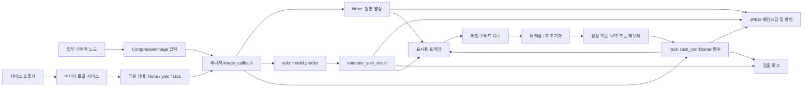
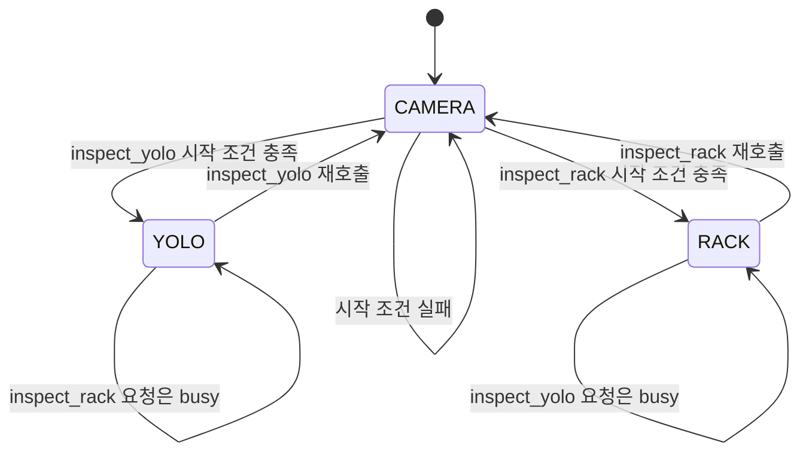
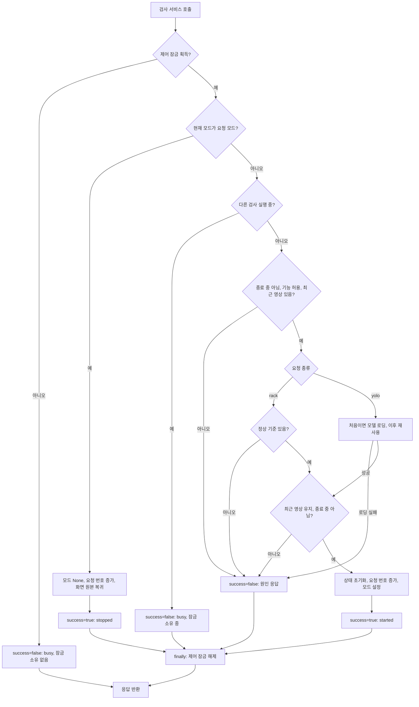
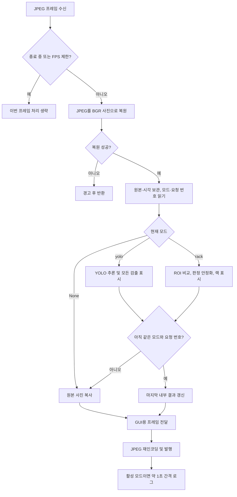
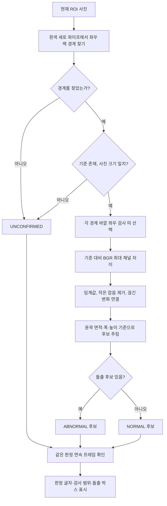
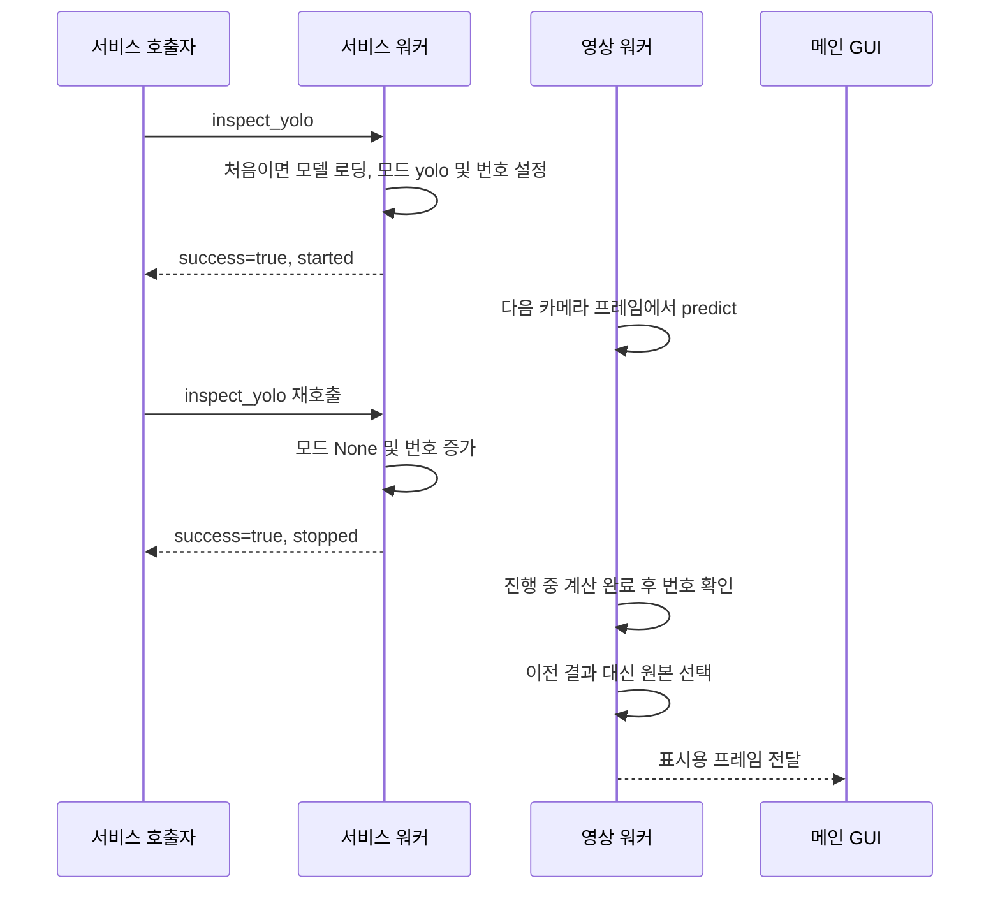

# scv_detection 설계·아키텍처·코드 리뷰 설명서

기준일: 2026-10-13. 현재 소스의 동작을 설명하는 문서이며 운영 기능 제안과 구현 완료 항목을 구분한다.

> 한 문장 설명: 카메라를 항상 구독하는 매니저 하나가 서비스로 선택한 검사 한 가지만 수행하고, 랙의 영상 분석 계산은 별도 함수 모듈에 맡긴다.

## 1. 요구사항과 설계 결정

| 요구사항 | 현재 구현 | 선택 이유 |
|---|---|---|
| 인자 없이 카메라부터 보고 싶다 | 기본 /robot4, show=true, 모드는 None | 카메라 연결 확인과 검사 실행을 분리한다 |
| YOLO와 랙 중 하나만 실행한다 | None/yolo/rack 중 하나만 보관 | 불가능한 “두 검사 동시 활성” 상태를 표현하지 않는다 |
| 호출하면 계속, 다시 호출하면 중지한다 | 같은 Trigger 서비스로 토글, 자동 종료 없음 | 시작·중지를 같은 명령으로 수동 제어한다 |
| 모델 경로를 매번 입력하지 않는다 | 패키지 share의 models/best.pt 자동 선택 | 사용자 홈 경로와 현재 실행 폴더에 의존하지 않는다 |
| 카메라만 볼 때는 모델을 로딩하지 않는다 | 첫 YOLO 시작 요청에서 지연 로딩 | 시작 비용과 모델 오류를 카메라 실행에서 분리한다 |
| 설비 계산을 따로 시험하고 확장한다 | rack_conditioner 함수 모듈 | ROS 실행·카메라·모델을 설비마다 복사하지 않는다 |
| 화면이 멈추지 않고 중지를 받는다 | 메인 GUI + 멀티스레드 executor | 영상 처리와 제어 요청을 별도 콜백 그룹으로 처리한다 |

작업 범위는 `scv_detection` 단독 실행이다. `scv_bringup`은 수정하지 않았다.
카메라 드라이버를 이 패키지가 직접 켜는 것은 아니다. 다른 노드가 발행한 JPEG를 받아 미리보기 창을 표시한다.

## 2. 현재 파일 구조와 책임

아래 경로의 기준 폴더는 `/home/mu-09/final_ws/ros2_ws/src/scv_detection`이다.

```text
scv_detection/
├── scv_detection/
│   ├── __init__.py                 # Python 패키지 표시, 별도 실행 로직 없음
│   ├── scv_detection_manager.py    # 유일한 ROS 실행 진입점과 공통 처리
│   └── rack_conditioner.py         # 랙 검출·기준 비교·안정화·그리기 함수 모음
├── models/
│   └── best.pt                    # 현재 6클래스 YOLO 가중치
├── config/
│   └── rack_reference.npz         # 정상 랙 기준 영상과 경계 좌표
├── launch/
│   └── detection_alert.launch.py  # 이 패키지만 실행하는 launch
├── resource/
│   └── scv_detection              # ament 패키지 인덱스 등록용 파일
├── test/
│   ├── test_detection_alert.py    # 매니저·서비스·YOLO 표시 회귀 시험
│   └── test_rack_conditioner.py   # 랙 함수·기준 저장/로드 시험
├── docs/
│   └── architecture.md           # 이 설명서
├── README.md
├── package.xml                   # ROS 의존성과 빌드 종류
├── setup.py                      # Python 패키지·자료·console_scripts 설치
├── setup.cfg                     # ROS 실행 스크립트 설치 위치
└── rosdep.yaml                   # Ultralytics 의존성 설치 키
```

실행은 다음 세 이름을 구분해야 한다.

| 종류 | 이름 | 의미 |
|---|---|---|
| ros2 run 실행 이름 | scv_detection_manager | setup.py의 console_scripts 키 |
| Python 클래스 | ScvDetectionManager | rclpy.node.Node를 상속한 대표 클래스 |
| ROS 노드 이름 | detection_alert | 토픽·private 서비스 이름을 구성하는 노드명 |

[setup.py](/home/mu-09/final_ws/ros2_ws/src/scv_detection/setup.py)의 실제 진입점:

```python
# ROS가 이 실행 이름을 찾으면 매니저의 main 함수를 호출한다.
'scv_detection_manager = scv_detection.scv_detection_manager:main'
```

`rack_conditioner.py`는 별도 노드·프로세스가 아니다. 매니저가 import하여 필요한 함수를 호출한다.
`detection_render.py`는 제거했다. 이전 `pressure_gauge.py`, `exit_sign.py`도 현재 파일 구조에 없다.
테스트 파일명 `test_detection_alert.py`는 유지했지만 시험 대상은 현재 매니저다.

### 왜 매니저와 모듈로 나눴는가?

매니저는 “언제, 무엇을 검사하고 어디로 보내는가”를 담당한다. 랙 모듈은 “사진에서 어떻게 돌출 후보를 찾는가”를 담당한다.
설비별로 ROS 노드를 추가하면 카메라 구독, 모드 전환, 화면 처리, 오류 대응을 중복 구현하기 쉽다.
현재 구조에서는 사진과 기준을 입력한 랙 함수를 ROS 서비스 없이 시험할 수 있다.

YOLO 표시는 모든 클래스에 동일한 박스·이름·신뢰도 처리를 적용한다.
현재 요구사항에는 독립 표시 모듈이나 클래스별 판정 함수가 필요하지 않아 매니저의 한 함수로 합쳤다.
설비별 계산이 복잡해지면 함수 모듈로 분리하되 영상 수신·모델 추론·ROS 실행은 매니저에 유지한다.

## 3. 전체 아키텍처: 영상 경로와 제어 경로



서비스 콜백은 검사 결과를 기다리는 작업 루프가 아니다.
검사 모드만 바꾸고 응답한다. 이후 수신되는 프레임을 `image_callback`이 현재 모드에 따라 처리한다.
단, 첫 YOLO 시작 서비스에는 모델 로딩 시간이 포함된다.

## 4. 상태 전이와 서비스 계약

`enable_yolo`와 `rack_enabled`는 서비스를 제공할지 정하는 설정이다.
둘 다 true여도 두 검사가 켜진 것은 아니다. 실제 실행 상태는 `_inspection_mode` 하나다.



| 현재 상태 | inspect_yolo 호출 | inspect_rack 호출 |
|---|---|---|
| None: 카메라 대기 | YOLO 시작 | 랙 시작 |
| yolo | YOLO 중지 → 대기 | busy, 기존 YOLO 유지 |
| rack | busy, 기존 랙 유지 | 랙 중지 → 대기 |

- 두 서비스 타입은 `std_srvs/srv/Trigger`이며 요청 내용은 `{}`이다.
- `success=true`는 시작 또는 중지에 성공했다는 뜻이다. 물체가 NORMAL이라는 뜻이 아니다.
- `message`에 `started`, `stopped`, `busy` 또는 실패 원인이 들어간다.
- 검사 판정은 영상과 로그에 표시한다. `_inspection_result`는 마지막 프레임의 내부 기록이며 외부 ROS 결과 메시지가 아니다.
- 다른 모드로 바로 전환하지 않는다. 현재 검사 중지 → 다른 검사 시작의 두 호출이 필요하다.
- 토글은 멱등적이지 않다. 즉 같은 요청을 두 번 보내면 상태가 원래대로 돌아온다. 재시도 정책은 운영 연동 전에 정해야 한다.

### 서비스 처리 플로우차트



잠금을 얻은 뒤 다른 모드 때문에 busy를 반환해도 `finally`에서 해제한다.
첫 잠금 획득 자체가 실패한 요청은 잠금을 소유하지 않으므로 해제하지 않는다.
중지 분기가 시작 조건보다 앞에 있어 카메라 단절이나 기준 누락 상태에서도 중지를 받는다.

## 5. 한 프레임의 처리 순서와 코드

[매니저 소스](/home/mu-09/final_ws/ros2_ws/src/scv_detection/scv_detection/scv_detection_manager.py)의 `image_callback`:



다음은 실제 분기 구조의 핵심 발췌다. 오류 처리·요청 번호 확인·발행 코드는 설명을 위해 생략했다.

```python
# 한 프레임에는 선택된 검사 하나만 실행한다. None이면 원본 복사본을 그대로 사용한다.
if mode == 'yolo':
    result = self.model.predict(
        source=frame, conf=self.conf, iou=self.iou, imgsz=self.imgsz,
        device=self.device, verbose=False,
    )[0]
    annotated, detections = self.annotate_yolo_result(result)
elif mode == 'rack':
    roi_frame, roi_box = self.crop_rack_roi(frame)
    rack_report = rack_conditioner.stabilize_result(
        rack_conditioner.inspect_rack(
            roi_frame, reference=self.reference_for_roi(roi_box),
            **self.rack_inspect_options),
        rack_state, self.rack_confirm_frames)
```

이 `if/elif`가 한 프레임에서 두 검사를 동시에 실행하지 않는 직접적인 근거다.
YOLO는 전체 사진을 분석하고 랙은 지정한 ROI만 분석한다.

처리가 오래 걸리는 동안 중지 요청이 오면 `_inspection_id`가 바뀐다.
처리 후 읽었던 번호와 현재 번호를 비교하여 이전 검사의 결과를 내부 상태·표시용 프레임에 채택하지 않는다.

```python
# 검사 시작·중지마다 번호를 바꾸고, 프레임 완료 때 같은 검사인지 확인한다.
if mode is not None and mode == self._inspection_mode and request_id == self._inspection_id:
    self._inspection_result = outcome
elif mode is not None:
    annotated = frame.copy()
    detections = []
    rack_report = None
    mode = None
```

중지는 이미 시작된 모델 계산 자체를 강제로 취소하지 않는다. 모드를 중지하고 완료된 옛 결과를 걸러낸다.
JPEG 발행 직전까지 원자적인 취소를 보장하는 설계는 아니므로 중지 직후의 화면·출력 지연은 별도 측정해야 한다.
대기 영상도 디코딩·재인코딩하므로 “검사 없는 원본 내용”이지 원본 JPEG 바이트의 그대로 전달은 아니다.

## 6. 매니저 함수별 역할과 입출력

| 함수 | 받는 것 → 돌려주는 것 | 하는 일과 이유 |
|---|---|---|
| _find_default_weights | 없음 → 모델 경로 문자열 | ament share에서 best.pt를 찾아 사용자별 경로를 없앤다 |
| _find_default_reference | 없음 → 기준 경로 또는 빈 문자열 | 설치 위치에서 개발 워크스페이스의 소스 config를 추정한다 |
| __init__ | ROS 노드 생성 옵션 → 노드 초기화 | 파라미터·잠금·서비스·영상 통신·GUI를 준비하고 모델은 아직 로딩하지 않는다 |
| crop_rack_roi | BGR 사진 → ROI 사진, 전체 사진 기준 좌표 | 0~1 비율 설정을 실제 픽셀로 바꿔 자른다 |
| reference_for_roi | ROI 좌표 → 기준 자료 또는 None | 현재 ROI 기준은 그대로, 과거 전체 사진 기준은 잘라 좌표를 옮긴다 |
| capture_rack_reference | 없음 → bool | 제어 잠금을 얻고 검사 대기 중에만 저장 작업을 허용한다 |
| _capture_rack_reference | 없음 → bool | 최신 ROI에서 파이프를 찾고 기준을 메모리·선택 NPZ에 저장한다 |
| reset_rack_reference | 없음 → bool | 대기 중 메모리 기준·연속 판정을 초기화한다. 파일은 지우지 않는다 |
| _load_yolo_model | 없음 → 반환값 없음 | 첫 요청 때 경로 확인·Torch/YOLO 로딩·장치 선택 후 모델을 재사용한다 |
| _handle_inspect_yolo | Trigger 요청·응답 → 응답 | 공통 제어 함수에 yolo를 전달한다 |
| _handle_inspect_rack | Trigger 요청·응답 → 응답 | 공통 제어 함수에 rack을 전달한다 |
| _handle_inspection | 모드·응답 → 응답 | 시작·중지 토글, 충돌 거절, 시작 조건 확인을 한곳에서 처리한다 |
| annotate_yolo_result | YOLO Results → 표시 사진, 로그 문자열 목록 | 모든 검출의 박스·이름·신뢰도를 클래스 색상으로 그린다 |
| image_callback | CompressedImage → 반환값 없음 | 사진 복원·선택 검사·표시·JPEG 발행·로그를 수행한다 |
| destroy_node | 없음 → ROS 정리 결과 bool | 종료 표시와 GUI·ROS 자원 정리를 수행한다 |
| main | 없음 → 반환값 없음 | ROS 시작, 노드·executor 생성, 메인 GUI 반복, 종료 정리를 담당한다 |

함수명 앞의 `_`는 모듈·클래스 내부에서 사용할 보조 기능이라는 의미다.
대표 클래스는 파일명에 맞춘 `ScvDetectionManager`이며 클래스명에는 밑줄이 없다.

## 7. YOLO 여섯 클래스 표시: 판정 목록이 아닌 ID 색상표

| ID | 현재 best.pt의 이름 | OpenCV BGR | 표시·로그 의미 |
|---:|---|---|---|
| 0 | Abnormal_left | (0, 0, 255) | 빨강, ABNORMAL |
| 1 | Abnormal_right | (0, 0, 255) | 빨강, ABNORMAL |
| 2 | Fire Extinguisher | (192, 192, 192) | 회색, UNCONFIRMED |
| 3 | Normal | (0, 255, 0) | 초록, NORMAL |
| 4 | Exit_sign_on | (0, 255, 0) | 초록, NORMAL |
| 5 | Exit_sign_off | (0, 0, 255) | 빨강, ABNORMAL |

색상은 RGB가 아니라 OpenCV의 BGR 순서다.
예전 `normal/good/pre_good` 등의 호환 이름 목록은 현재 사용하지 않는다.
실제 검출된 클래스만 표시한다. 모델에 여섯 클래스가 있다는 이유로 매 프레임에 여섯 개가 모두 나타나는 것은 아니다.

`annotate_yolo_result`는 `result.orig_img` 복사본에 모든 박스·이름·신뢰도를 그린다.
등록되지 않은 ID도 회색으로 표시하며 제외하지 않는다.
로그 문자열 예시는 `Normal:0.90 verdict=NORMAL`이다.

전체 소화기 클래스는 물체의 존재를 보여 줄 뿐 압력계 정상 상태를 증명하지 않는다.
현재 YOLO 경로에는 별도 압력계 정면성 검사나 여러 프레임 판정 안정화가 없다.
모델 교체 시 실제 `model.names`와 ID 색상표가 일치하는지 확인해야 한다.

## 8. 랙 알고리즘: 정상 사진과 바깥 검사 띠의 변화 비교

[랙 모듈 소스](/home/mu-09/final_ws/ros2_ws/src/scv_detection/scv_detection/rack_conditioner.py)는 다음 순서로 동작한다.



위 흐름의 NORMAL은 “검사한 띠에서 유효한 변화 후보가 없음”이라는 뜻이다.
현재 코드에는 띠가 모두 너무 작아 검사에서 제외된 경우에도 NORMAL로 내려가는 경계 조건이 있다. 안전한 판정 조건 보완은 13절에 구분했다.

### 8.1 경계 검출과 기준 준비

`detect_rack`은 HSV에서 밝고 채도가 낮은 흰색 후보를 고르고, 세로로 길게 이어진 픽셀 열을 찾는다.
잡음을 제거한 뒤 ROI 높이의 30% 이상 이어지는 후보를 묶고, 폭·거리·높이 유사성이 맞는 파이프 두 개를 선택한다.
반환값은 `{'left', 'right', 'top', 'bottom'}` 좌표 dict이며 실패하면 None이다.

정상으로 적재한 상태에서 N을 누르면 매니저가 최신 ROI를 전달한다.
`capture_reference`는 사진과 좌표를 복사한다. 내부 밝기 표준편차가 8 미만이면 빈 화면으로 보고 거절한다.
이는 운영자가 정상 상태를 확인하는 절차를 대신하지 않는다.

NPZ에는 `frame`, `rack_left`, `rack_right`, `rack_top`, `rack_bottom`이 들어간다.
R은 메모리 기준만 지우며 파일을 삭제하지 않는다. N/R은 검사 중에는 거절한다.

### 8.2 검사 띠·색상 비교·연속 확인

매니저 기본 설정에서 경계 바깥 30~90픽셀 구간을 비교한다.
세로는 파이프 높이의 위 12%, 아래 4%를 제외한다.
현재 경계와 기준 경계의 각 띠를 기준으로 같은 크기 영역을 비교하되 원근 변화까지 정합하지는 않는다.

```python
# 밝기만 비교하지 않고 BGR 중 가장 크게 달라진 채널을 사용한다.
diff = cv2.absdiff(ref_zone, cur_zone)
if len(diff.shape) == 3:
    diff = diff.max(axis=2)
changed = cv2.threshold(diff, diff_threshold, 255, cv2.THRESH_BINARY)[1]
```

이후 OPEN 5×5로 작은 잡음을 제거하고 CLOSE 9×9로 끊긴 변화 영역을 연결한다.
윤곽 면적 300픽셀 이상, 폭 8픽셀 이상, 높이 15픽셀 이상을 돌출 후보로 남긴다.
랙 안쪽 적재 변화는 이 검사 대상이 아니다.

`stabilize_result`는 같은 판정이 기본 3개 **처리 프레임** 연속으로 나올 때 확정한다.
3초라는 뜻이 아니다. 미확인이나 좌우 경계의 15픽셀 초과 이동은 연속 상태를 초기화한다.

### 8.3 랙 함수별 역할

| 함수 | 입력 → 반환 | 역할 |
|---|---|---|
| _longest_run_per_column | 흰색 마스크 → 열별 최장 길이·시작 행 배열 | 세로 파이프 후보의 연속성을 계산한다 |
| detect_rack | BGR 사진 → 경계 dict 또는 None | 흰색 파이프 두 개를 찾는다 |
| capture_reference | 사진·경계 → 기준 dict 또는 None | 정상 비교용 복사본을 만든다 |
| save_reference | 기준 dict·파일 경로 → 반환값 없음 | 폴더를 준비하고 NPZ를 저장한다 |
| load_reference | 파일 경로 → 기준 dict 또는 None | 파일이 없거나 읽기 실패 시 기준 없음으로 처리한다 |
| _check_zone | 기준·현재 띠 → 변화 bbox·면적 목록 | BGR 차이와 윤곽 필터로 후보를 추린다 |
| inspect_rack | 사진·선택 경계·기준·옵션 → report dict | 미확인·정상·이상과 이유·검사 구역·돌출 후보를 만든다 |
| stabilize_result | report·상태 dict·필요 프레임 수 → 안정화 report | 상태 dict를 갱신하고 확정 전에는 미확인으로 돌려준다 |
| draw_result | 사진·report → 표시 사진 | 원본을 보존하고 노란 검사 범위, 빨간 돌출 박스, 판정 글자를 그린다 |
| scale_display_point | 창 좌표·사진 크기 → 사진 좌표 또는 None | 좌표 환산 보조 함수. 현재 매니저에서는 호출하지 않는다 |

랙 함수의 기본 인자는 margin=10, zone_width=70, diff_threshold=25다.
실제 노드에서는 매니저가 30/90/35를 명시 전달하므로 운용 기본값과 함수 자체 기본값을 혼동하면 안 된다.

## 9. 스레드·콜백 그룹·잠금의 역할

| 실행 위치·장치 | 책임 | 막는 문제 |
|---|---|---|
| 메인 스레드 | 창 생성·imshow·waitKey·N/R | GUI가 콜백 처리에 섞여 멈추는 문제 |
| spin 관리 스레드 | executor.spin 호출 | 메인 GUI 루프를 ROS spin으로 막는 문제 |
| executor 워커 3개 | 영상 콜백과 서비스 콜백 | 영상 처리 중 제어 요청을 못 받는 문제 |
| 기본 MutuallyExclusive 그룹 | image_callback | 같은 노드의 영상 처리를 동시에 겹치지 않게 한다 |
| 별도 Reentrant 그룹 | 두 검사 서비스 | 제어 요청끼리 겹칠 때 busy를 응답할 수 있게 한다 |
| _inspection_lock | 시작·중지·N/R의 전체 제어 작업 | 동시 모델 로딩·모드 변경·기준 변경 충돌 |
| _state_lock: RLock | 모드·프레임·결과의 짧은 공유 접근 | 서로 다른 스레드의 상태 읽기·쓰기를 보호한다 |
| _inspection_id | 검사 세대 번호 | 중지 이전의 결과가 다음 검사에 섞이는 문제 |
| _stop_event | 노드 종료 표시 | 종료 중 새 영상 처리나 시작 요청 방지 |

워커가 세 개라고 YOLO·랙·서비스가 각각 전용 스레드를 하나씩 갖는 것은 아니다.
선택된 추론 또는 랙 계산은 영상 콜백 안에서 동기적으로 수행된다.
긴 계산 동안 상태 잠금을 계속 잡지 않으므로 다른 워커가 중지 요청을 처리할 수 있다.



모델 로딩 중에는 제어 잠금이 유지된다. 이때 다른 요청은 busy이며 로딩 작업을 취소하는 서비스는 없다.
노드 종료 시에는 종료 표시 → executor shutdown → spin 스레드 join → 노드·창 정리 → rclpy shutdown 순서다.

## 10. ROS 인터페이스와 주요 설정

| 종류 | 기본 /robot4 주소 | 타입·의미 |
|---|---|---|
| 영상 입력 | /robot4/oakd/rgb/image_raw/compressed | sensor_msgs/msg/CompressedImage |
| 영상 출력 | /robot4/fire_extinguisher/detections/compressed | 원본 내용 또는 검사 표시 JPEG |
| YOLO 제어 | /robot4/detection_alert/inspect_yolo | std_srvs/srv/Trigger |
| 랙 제어 | /robot4/detection_alert/inspect_rack | std_srvs/srv/Trigger |

토픽은 코드에서 상대 이름, 서비스는 `~/inspect_...` private 이름을 사용한다.
상대 토픽은 이름공간에 따라, private 서비스는 이름공간과 노드 이름에 따라 주소가 달라진다.
출력 header는 입력 header를 복사한다. 현재 입력·출력 QoS는 RELIABLE / KEEP_LAST / depth 1이다.
카메라 발행 측 QoS도 현장 연결 시험에서 확인해야 한다.

`scv_msgs/msg/InspectionResult`는 랙의 NORMAL/ABNORMAL/UNCONFIRMED 상수만 가져온다.
이 메시지를 발행하는 publisher, Alert 발행, `InspectFacility` 액션 서버는 현재 구현하지 않았다.

| 설정 | 기본값 | 의미 |
|---|---|---|
| weights | 빈 문자열 | 자동 선택; 명시 경로가 있으면 우선 사용 |
| show | true | GUI 표시, 화면 환경 없으면 비활성화 |
| enable_yolo / rack_enabled | true / true | 해당 서비스를 생성할지 결정 |
| camera_timeout | 2.0초 | 시작 시 마지막 처리된 유효 영상의 최신성 조건 |
| conf / iou / imgsz | 0.25 / 0.45 / 640 | YOLO 추론 설정 |
| device | auto | CUDA 가능하면 0, 아니면 cpu |
| max_fps / jpeg_quality | 10.0 / 85 | 처리 빈도 상한과 출력 JPEG 품질 |
| rack_roi_x1/y1/x2/y2 | 0.25 / 0.30 / 0.75 / 0.83 | 사진에서 랙을 찾을 비율 영역 |
| rack_margin / rack_zone_width | 30 / 90 | 경계 바깥 검사 띠의 시작·끝 픽셀 |
| rack_diff_threshold / rack_min_area | 35 / 300 | 색상 차이와 윤곽 면적 기준 |
| rack_confirm_frames | 3 | 확정할 연속 처리 프레임 수 |
| rack_reference_path | 자동 추정 또는 빈 값 | NPZ 저장·로드 위치; 빈 값이면 메모리만 사용 |

예전 검사 duration/inspect_timeout 설정은 제거했다.
`camera_timeout`은 검사 지속 시간을 제한하지 않고 실행 중 카메라 장애를 감시하지도 않는다.
대부분의 설정은 생성 시 속성으로 저장하므로 변경 후 재시작하는 방식이 현재 기준이다.

### 모델과 기준 파일의 배포 차이

모델은 setup.py의 data_files로 `share/scv_detection/models/best.pt`에 설치하고 ament 인덱스로 찾는다.
이것은 단순히 `__file__` 옆 상대 경로를 붙이는 것과 다르며 설치 환경에서도 패키지 위치를 기준으로 찾는다.

반면 config의 기준 NPZ와 이 architecture.md는 현재 setup.py의 설치 자료 목록에 없다.
기준 기본 경로는 설치 prefix에서 소스 config를 추정하는 개발 워크스페이스용 편의 기능이다.
독립 배포나 merge-install에서 같은 경로 발견을 보장하지 않으므로 운용 시 기준 경로를 명시하거나 배포 정책을 추가해야 한다.

## 11. 실행·확인·빌드 명령

노드 실행:

```bash
ros2 run scv_detection scv_detection_manager
```

다른 터미널에서 YOLO 시작 또는 중지:

```bash
ros2 service call /robot4/detection_alert/inspect_yolo std_srvs/srv/Trigger "{}"
```

랙 시작 또는 중지:

```bash
ros2 service call /robot4/detection_alert/inspect_rack std_srvs/srv/Trigger "{}"
```

robot3 또는 화면 없는 환경:

```bash
ros2 run scv_detection scv_detection_manager --ros-args -r __ns:=/robot3 -p show:=false
```

패키지 단독 launch:

```bash
ros2 launch scv_detection detection_alert.launch.py
```

변경 반영 빌드:

```bash
cd /home/mu-09/final_ws/ros2_ws
colcon build --symlink-install --packages-select scv_detection
source install/setup.bash
```

새 터미널의 bashrc 자동 source는 이미 열린 터미널을 갱신하지 않는다.
설치 방식 변경 뒤 Python 패키지 메타데이터 경로를 찾지 못하면 다시 source 또는 새 터미널을 사용한다.
빌드·source 후에도 실행 중인 노드의 코드가 바뀌는 것은 아니므로 노드를 재시작해야 한다.

## 12. 확인한 근거와 아직 확인하지 않은 것

| 확인 항목 | 근거 | 확인 범위 |
|---|---|---|
| 기본 실행·경로·이름공간·GUI fallback | test_detection_alert.py | 노드 설정 및 오류 대응 |
| 여섯 클래스 색상·이름·미등록 ID | 합성 YOLO Results 테스트 | 표시·로그 경로, 실영상 검출 정확도 아님 |
| 시작·중지 반복, 6초 뒤 유지, busy | 서비스 단위 시험 | 모드 유지·재사용·상호 배제 |
| 카메라 단절 후 중지·로딩 중 겹친 요청 | 서비스 회귀 시험 | 제어 실패·중지 경로 |
| 랙 정상·돌출·미확인·기준 NPZ | test_rack_conditioner.py | 합성 사진과 파일 저장·로드 |
| 선택 단위·회귀 시험 46개 통과 | 두 test 파일 실행 결과 | 이 두 파일의 파라미터 조합 포함 |
| 실제 ROS 서비스 6초 이상 지속·중지 | 별도 ROS 도메인, 합성 JPEG | 서비스 통신과 영상 파이프라인 |
| 실제 best.pt CPU 실행·6클래스 로딩 | 위 ROS 시험의 YOLO 경로 | 모델 로딩·추론·출력 경로 |
| symlink 빌드 성공 | colcon build 실행 결과 | scv_detection 선택 빌드 |

시험 재실행:

```bash
cd /home/mu-09/final_ws
source /opt/ros/jazzy/setup.bash
source ros2_ws/install/setup.bash
python3 -m pytest ros2_ws/src/scv_detection/test/test_detection_alert.py ros2_ws/src/scv_detection/test/test_rack_conditioner.py -q
```

46개 시험 통과는 실제 로봇 영상의 precision/recall, 안전성 승인, 장시간 안정성 또는 6클래스 모두 실물 검출을 뜻하지 않는다.
이전 5클래스 모델의 평가 수치는 현재 6클래스 모델의 성능 근거로 사용하지 않는다.

## 13. 운영 적용 전 검토 사항

현재 구현에서 확인한 적용 범위와 운영 연동 전 보완 사항은 다음과 같습니다.
각 항목은 현재 코드의 동작을 기준으로 정리했으며, 보완 구현과 현장 검증은 후속 작업으로 구분합니다.

| 검토 항목 | 현재 구현 및 적용 범위 | 보완·검증 사항 |
|---|---|---|
| 유효 랙 검사 구역 | 띠 폭이 10픽셀 미만이거나 높이가 30픽셀 미만이면 비교에서 제외됩니다. 모든 구역이 제외되어도 현재 코드에서는 NORMAL이 반환될 수 있습니다 | 유효 구역이 확보되지 않으면 UNCONFIRMED로 보류하도록 조건 보완 및 회귀 시험 |
| 운영 판정 인터페이스 | Trigger 응답은 시작·중지 제어 결과이며 검사 판정은 영상과 로그로 제공합니다 | 자동화 연동용 판정 토픽 또는 액션 요구사항 확정 |
| 토글 재시도 | 같은 서비스의 중복 호출이나 재시도로 검사 상태가 다시 전환될 수 있습니다 | 명시적 start/stop 또는 목표 모드 지정 API 검토 |
| 카메라 단절 | 최근 영상 확인은 시작 시 수행합니다. 실행 중 단절되면 모드와 마지막 화면이 유지될 수 있습니다 | 수신 시각 표시, 장애 감시 및 미확인 처리 정책 검증 |
| 첫 모델 로딩·진행 중 추론 | 모델 로딩 중 제어 요청은 busy로 응답합니다. 중지 요청은 진행 중 계산 자체를 강제 취소하지 않습니다 | 초기 로딩 시간, 중지 응답 및 화면·출력 반영 지연 측정 |
| 모델 색상 매핑 | 클래스 ID별 색상표를 사용하며 모델의 ID·이름 일치를 자동으로 강제 검증하지 않습니다 | 모델 교체 시 클래스 ID·이름과 색상표 일치 확인 |
| 기준 저장 신뢰성 | 운영자가 정상 기준 사진을 선택합니다. 오래된 영상의 저장 방지와 파일 저장 실패 대응은 추가 보완이 필요합니다 | 영상 최신성, 저장 권한·디스크 오류 대응 및 정상 기준 적합성 검증 |
| 랙 관측 범위 | 좌우 경계 바깥의 영상 변화를 검사합니다. 앞뒤 실제 거리 측정, 랙 내부 검사 및 다중 랙 검사는 현재 범위에 포함되지 않습니다 | 요구사항에 따른 센서, ROI 및 다중 랙 처리 설계 |
| 조명·그림자·시점 | 사람, 그림자 및 광량 변화가 색상 차이로 검출될 수 있습니다 | 실제 환경 데이터 확보, 기준 영상 정합 및 오검출 시험 |
| 화면 없는 환경의 기준 준비 | GUI가 없으면 N/R 키로 기준을 생성·초기화할 수 없습니다 | 사전 NPZ 준비 또는 별도 기준 생성 인터페이스 검토 |
| QoS·배포·동적 설정 | 현재 통신 설정, 소스 경로 기반 기준 탐색 및 초기화 시 저장하는 파라미터를 사용합니다 | 카메라 발행 측 QoS 호환성, 배포 경로 및 설정 변경 정책 검증 |

운영 적용 전 우선 보완 항목은 **유효 랙 검사 구역이 없는 경우의 판정 보류 조건**입니다.
현재 검증 범위는 서비스 기반 수동 검사와 영상·로그 표시입니다.
자동 순찰의 판정 기능으로 연동하기 위해서는 위 보완 사항과 실제 환경 성능 검증이 필요합니다.

## 14. 설계 요약

이 패키지는 카메라 수신, 모델 추론, ROS 서비스 및 화면 처리를 하나의 매니저에서 관리하도록 설계했습니다.
랙 분석은 사진·기준·상태를 입력받는 함수 모듈로 분리하여 공통 처리의 중복을 줄이고 알고리즘을 독립적으로 시험할 수 있도록 구성했습니다.
YOLO 표시는 모든 검출에 동일한 절차를 적용하므로 클래스별 색상표와 하나의 표시 함수로 통합했습니다.

기본 실행 상태는 카메라 미리보기이며, 서비스 호출에 따라 YOLO 또는 랙 검사 중 한 가지만 수행합니다.
같은 서비스를 다시 호출하면 검사를 중지하고 카메라 미리보기로 돌아갑니다.
기능 허용 설정과 실제 검사 모드를 구분하고, 상태 값과 분기 구조로 두 검사의 동시 실행을 제한합니다.

서비스 응답은 시작·중지의 제어 성공 여부를 나타내며 검사 판정과 구분합니다.
중지 시에는 검사 모드를 변경하고 요청 번호로 이전 계산 결과를 제외하지만, 이미 진행 중인 모델 계산을 강제로 중단하지는 않습니다.
랙 검사는 정상 기준과 경계 바깥의 색상 변화를 비교하는 2D 영상 방식이며 실제 돌출 거리를 측정하는 기능은 아닙니다.

현재까지 단위·회귀 시험과 실제 ROS 통신 시험으로 제어, 영상 처리 및 표시 경로를 확인했습니다.
이 검증 결과와 실제 환경의 검출 정확도·장시간 안정성은 구분하여 평가합니다.
다음 단계에서는 유효 검사 구역의 판정 보류 조건, 구조화된 판정 인터페이스 및 현장 성능 검증을 보완할 계획입니다.
