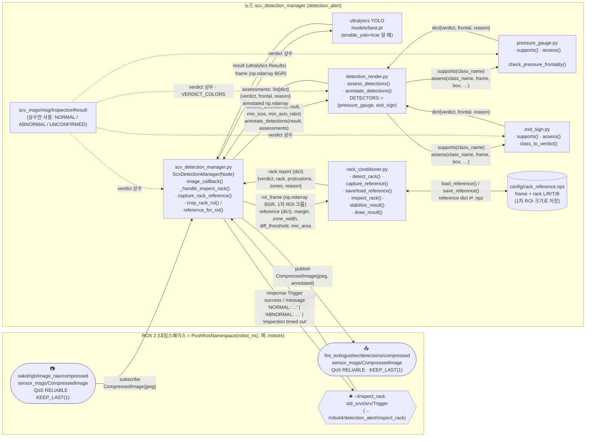
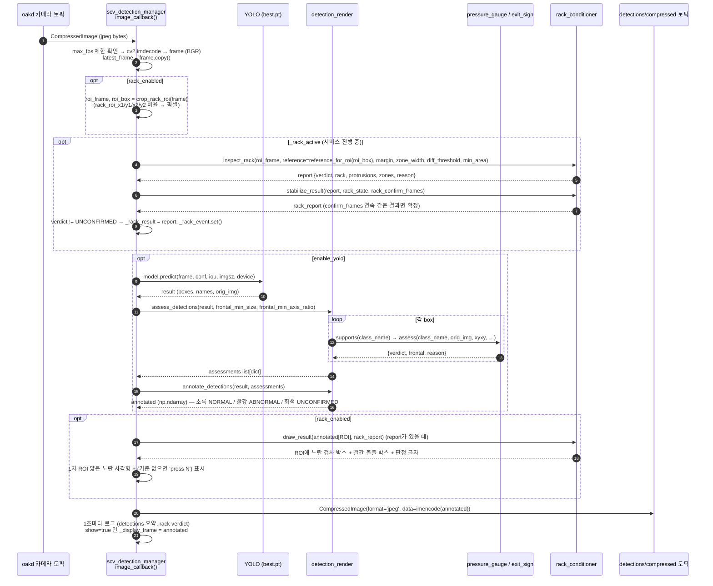
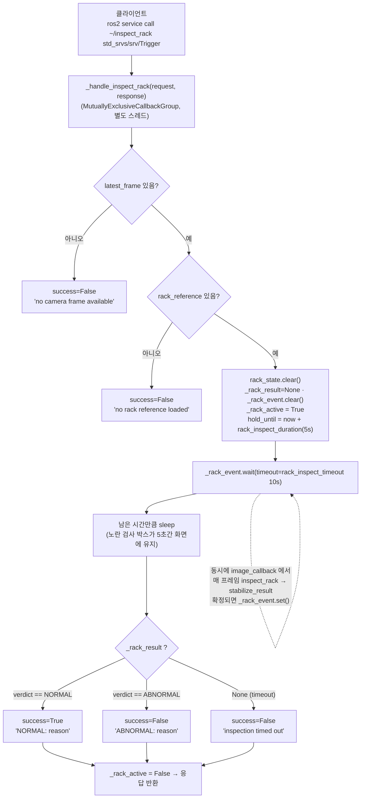
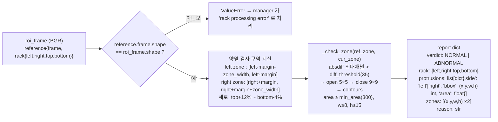
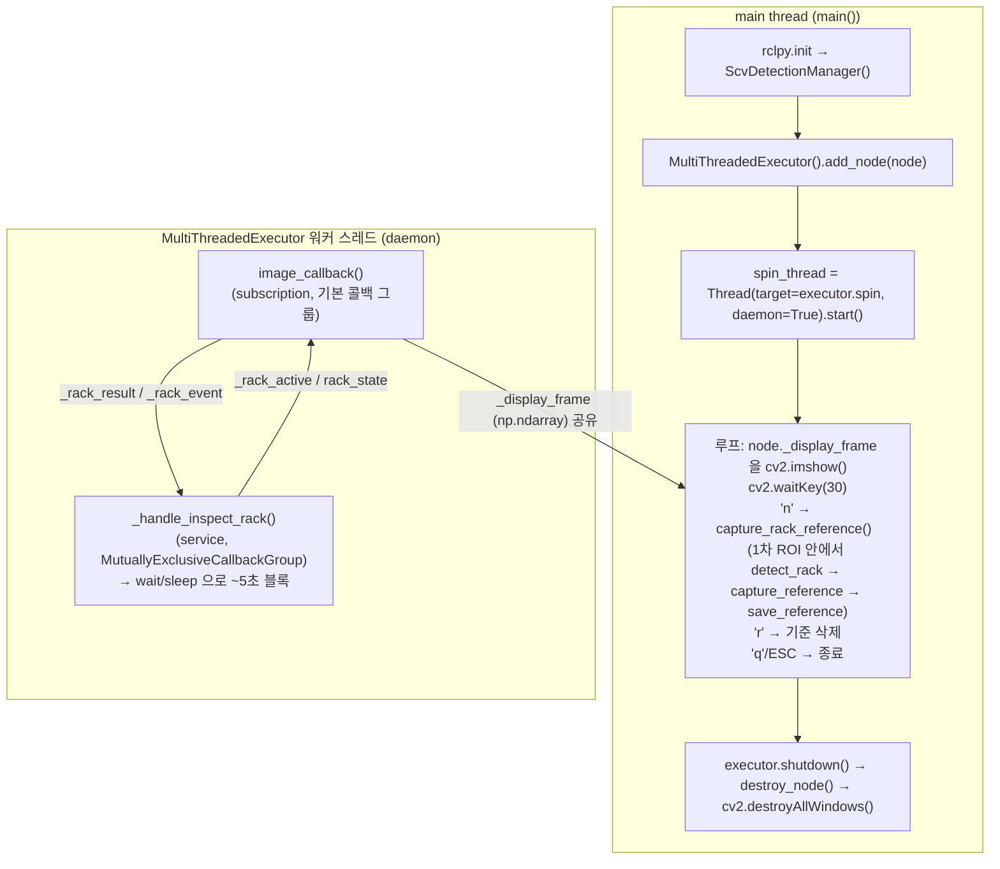

# scv_detection 패키지 구조도 (rqt_graph 스타일)

작성 기준: 2026-10-12, mu-09 PC의 `scv_detection_manager.py` 현재 코드.
Mermaid 블록은 GitHub / VS Code(Markdown Preview Mermaid) / draw.io(Arrange → Insert → Advanced → Mermaid)에서 바로 그려진다.

---

## 1. 전체 구조 (ROS 2 통신 + 모듈 호출)



> **참고**: `InspectionResult` 메시지는 이 노드에서 **발행하지 않는다**. `verdict` 상수(NORMAL=0, ABNORMAL=4, UNCONFIRMED=5)와 색상 매핑에만 쓰인다.
> `{ns}/inspect/result` 발행은 msg 파일 주석에는 계획되어 있으나 현재 코드에는 없다.

---

## 2. 데이터 흐름 ① — 영상 수신 → YOLO → 설비 판정 → 발행 (매 프레임)



---

## 3. 데이터 흐름 ② — 서비스 호출 → 랙 돌출 검사 (약 5초 유지)



### rack_conditioner.inspect_rack 내부



---

## 4. 스레드 구성



> cv2.imshow 는 **반드시 main thread** 에서 호출한다. 워커 스레드에서 imshow 하면 콜백이 멈춘다 (이전 버전에서 확인된 문제).
> 서비스 핸들러가 5초간 블록되어도 image_callback 은 다른 워커 스레드에서 계속 돈다.

---

## 5. 텍스트 요약 (Mermaid 가 안 보일 때)

```
[oakd/rgb/image_raw/compressed]  (CompressedImage, RELIABLE)
            │ subscribe
            ▼
┌───────────────────────── scv_detection_manager.py ──────────────────────────┐
│ image_callback(frame BGR)                                                   │
│   ├─ crop_rack_roi(frame) ──► roi_frame, roi_box     (rack_enabled)        │
│   ├─ [_rack_active] rack_conditioner.inspect_rack(roi_frame, reference)    │
│   │        └─► stabilize_result() ──► rack report {verdict, protrusions…}  │
│   ├─ [enable_yolo] YOLO.predict(frame) ──► result                           │
│   │        └─► detection_render.assess_detections(result) ──► assessments  │
│   │                 ├─► pressure_gauge.supports()/assess() ─► {verdict,…}  │
│   │                 └─► exit_sign.supports()/assess()      ─► {verdict,…}  │
│   │        └─► detection_render.annotate_detections(result, assessments)   │
│   ├─ rack_conditioner.draw_result(annotated[ROI], rack_report)             │
│   └─ publish ──► [fire_extinguisher/detections/compressed]                  │
│                                                                             │
│ _handle_inspect_rack(Trigger)  ◄── [~/inspect_rack]  (std_srvs/Trigger)     │
│   _rack_active=True → event.wait(≤10s) → 5s 유지 → NORMAL/ABNORMAL/timeout │
│                                                                             │
│ main thread: executor.spin (daemon) ‖ cv2.imshow + 'n'(기준 저장) 'r'(삭제) │
└─────────────────────────────────────────────────────────────────────────────┘
      scv_msgs/InspectionResult : verdict 상수(NORMAL/ABNORMAL/UNCONFIRMED)만 사용
      config/rack_reference.npz : 1차 ROI 크기 기준 영상 + rack L/R/T/B
```

## 6. 주요 파라미터 (현재 mu-09 값)

| 파라미터 | 값 | 의미 |
|---|---|---|
| rack_roi_x1 / y1 / x2 / y2 | 0.25 / 0.30 / 0.75 / 0.83 | 1차 ROI (화면 비율) |
| rack_diff_threshold | 35 | 기준 대비 픽셀 차이 임계값 |
| rack_min_area | 300 | 돌출로 볼 최소 면적(px) |
| rack_margin | 30 | 파이프에서 검사 구역까지 띄우는 간격(px) |
| rack_zone_width | 90 | 좌/우 검사 구역 너비(px) |
| rack_confirm_frames | 3 (기본) | 같은 결과가 몇 프레임 연속이면 확정 |
| rack_inspect_duration | 5.0 s | 서비스 중 검사 박스 유지 시간 |
| rack_inspect_timeout | 10.0 s | 판정 확정 대기 상한 |
| rack_reference_path | config/rack_reference.npz | 기준 영상 파일 |

---

## 7. 인터페이스 상세 표 — 모든 화살표의 값·타입·형식

### 7-1. ROS 2 통신

| 방향 | 이름 (robot_ns=/robot4 기준 실제 이름) | 메시지 타입 | 사용하는 필드 → 값 |
|---|---|---|---|
| Subscribe | `oakd/rgb/image_raw/compressed` → `/robot4/oakd/rgb/image_raw/compressed` | `sensor_msgs/msg/CompressedImage` | `data: uint8[]` (JPEG 바이트) → `np.frombuffer(uint8)` → `cv2.imdecode` → `frame: np.ndarray(H,W,3) uint8 BGR`. `header`, `format` 은 읽지 않음. QoS RELIABLE / KEEP_LAST depth 1 (30 Hz) |
| Publish | `fire_extinguisher/detections/compressed` → `/robot4/fire_extinguisher/detections/compressed` | `sensor_msgs/msg/CompressedImage` | `header = 입력 메시지 header 그대로 복사`, `format = "jpeg"`, `data = cv2.imencode(".jpg", annotated, JPEG_QUALITY=jpeg_quality)` 바이트. 처리 주기는 `max_fps`(기본 10) 로 제한. QoS RELIABLE / KEEP_LAST 1 |
| Service server | `~/inspect_rack` → `/robot4/detection_alert/inspect_rack` | `std_srvs/srv/Trigger` | 요청: 필드 없음. 응답: `success: bool`, `message: string` = `"NORMAL: <reason>"` (success=True) / `"ABNORMAL: <reason>"` / `"inspection timed out"` / `"no camera frame available"` / `"no rack reference loaded"` (모두 success=False) |
| Launch | `detection_alert.launch.py` | `PushRosNamespace(LaunchConfiguration('robot_ns'))` | 노드 파라미터: `weights: str`, `enable_yolo: bool`, `rack_enabled: bool`, `device: str`, `show: bool` |
| (상수만) | — | `scv_msgs/msg/InspectionResult` | `NORMAL=0`, `ABNORMAL=4`, `UNCONFIRMED=5` (uint8). 발행하지 않음 |

### 7-2. manager → rack_conditioner

| 호출 | 입력 (값: 타입) | 반환 |
|---|---|---|
| `crop_rack_roi(frame)` (manager 내부) | `frame: np.ndarray(H,W,3) BGR` | `(roi_frame: np.ndarray(h,w,3) BGR 복사본, roi_box: tuple(x1,y1,x2,y2) int 전체화면 픽셀)` — 비율 `rack_roi_*` × (W,H) |
| `reference_for_roi(roi_box)` (manager 내부) | `roi_box: tuple[int,int,int,int]` | `reference: dict{'frame': np.ndarray(h,w,3), 'rack': dict{'left','right','top','bottom': int}}` (ROI 좌표계) 또는 `None` |
| `detect_rack(roi_frame)` | `frame: np.ndarray(h,w,3) BGR` | `rack: dict{'left': int, 'right': int, 'top': int, 'bottom': int}` (파이프 중심 x, 파이프 세로 범위 y) 또는 `None` |
| `capture_reference(roi_frame, rack)` | `frame: np.ndarray`, `rack: dict` | `reference: dict{'frame': frame.copy(), 'rack': dict(rack)}` 또는 `None` (랙 내부 std < 8) |
| `save_reference(reference, path)` | `reference: dict`, `path: str` | `.npz` 키: `frame (h,w,3) uint8`, `rack_left, rack_right, rack_top, rack_bottom (int)` |
| `load_reference(path)` | `path: str` | 위 `.npz` → `reference: dict{'frame', 'rack'{...}}` 또는 `None` |
| `inspect_rack(roi_frame, reference=…, margin=30, zone_width=90, diff_threshold=35, min_area=300)` | `frame: np.ndarray(h,w,3)`, `reference: dict`, 나머지 int | `report: dict{'verdict': uint8(0/4/5), 'reason': str, 'rack': dict{'left','right','top','bottom'} \| None, 'protrusions': list[dict{'side': 'left'\|'right', 'bbox': (x,y,w,h) int ROI좌표, 'area': float}], 'zones': list[tuple(x,y,w,h) int]}` (zones 최대 2개) |
| `stabilize_result(report, rack_state, rack_confirm_frames)` | `report: dict`, `state: dict{'verdict','count','rack'}` (manager 가 소유, in-place 갱신), `required_frames: int` | 같은 구조의 `report` 복사본. `count < required_frames` 면 `verdict=UNCONFIRMED`, `reason='confirming k/N'` |
| `draw_result(annotated[y1:y2, x1:x2].copy(), rack_report)` | `frame: np.ndarray(h,w,3)` ROI 영역, `report: dict` | `np.ndarray(h,w,3)` — 노란(0,255,255) 검사 박스(랙+zones+pad 15, 두께 2), 빨간(0,0,255) 돌출 박스(두께 3), `'RACK: NORMAL/ABNORMAL/UNCONFIRMED'` 텍스트 → manager 가 `annotated[y1:y2, x1:x2]` 에 다시 붙임 |

내부: `_check_zone(ref_zone, cur_zone, diff_threshold, min_area)` → `list[dict{'bbox': (x,y,w,h), 'area': float}]` (zone 좌표계; inspect_rack 이 ROI 좌표로 옮김)

### 7-3. manager → YOLO → detection_render → 설비 모듈

| 호출 | 입력 (값: 타입) | 반환 |
|---|---|---|
| `model.predict(source=frame, conf, iou, imgsz, device, verbose=False)` | `frame: np.ndarray(H,W,3) BGR`, `conf: float`, `iou: float`, `imgsz: int`, `device: str` | `result: ultralytics.engine.results.Results` — 사용 필드 `result.boxes` (`xyxy: Tensor(N,4)`, `cls: Tensor(N)`, `conf: Tensor(N)`), `result.names: dict{int: str}`, `result.orig_img: np.ndarray` |
| `assess_detections(result, frontal_min_size: int=48, frontal_min_axis_ratio: float=0.90)` | `result: Results` | `assessments: list[dict{'verdict': uint8, 'frontal': bool \| None, 'reason': str}]` — `result.boxes` 와 같은 순서·길이. 지원 안 하는 클래스 → `{UNCONFIRMED, None, 'unsupported class'}` |
| `annotate_detections(result, assessments)` | `result: Results`, `assessments: list[dict]` | `annotated: np.ndarray(H,W,3) BGR` (`orig_img.copy()` 위에 Annotator 로 박스+라벨 `"<class> <conf:.2f>"` 또는 `'UNCONFIRMED (pose/outline)'`; 색 NORMAL 초록 / ABNORMAL 빨강 / UNCONFIRMED 회색) |
| `pressure_gauge.supports(class_name: str)` | `result.names[int(box.cls)]` | `bool` — `{'normal','abnormal_left','abnormal_right','pre_good','good','bad'}` (소문자 비교) |
| `pressure_gauge.assess(class_name, frame, box, min_size, min_axis_ratio)` | `class_name: str`, `frame: result.orig_img np.ndarray`, `box: list[float] xyxy (box.xyxy[0].cpu().tolist())` | `dict{'verdict': uint8, 'frontal': bool \| None, 'reason': str}` — 내부 `check_pressure_frontality()` → `(frontal: bool \| None, reason: str)`; 정면(axis ratio ≥ 0.90)일 때만 `normal/good/pre_good → NORMAL`, 나머지 → `ABNORMAL`, 아니면 `UNCONFIRMED` |
| `exit_sign.supports(class_name: str)` | 같음 | `bool` — `{'exit_sign_on','exit_sign_off'}` |
| `exit_sign.assess(class_name, frame, box, …)` | 같음 (frame/box 미사용) | `dict{'verdict': exit_sign_on→NORMAL / exit_sign_off→ABNORMAL / 기타→UNCONFIRMED, 'frontal': None, 'reason': 'frontality check not required for this class'}` |

현재 `best.pt` 클래스: `{0:'Abnormal_left', 1:'Abnormal_right', 2:'Normal', 3:'Exit_sign_on', 4:'Exit_sign_off'}` → 0·1·2 는 pressure_gauge, 3·4 는 exit_sign 이 담당.

### 7-4. 스레드 간 공유 변수

| 변수 | 타입 | 쓰는 쪽 → 읽는 쪽 |
|---|---|---|
| `latest_frame` | `np.ndarray(H,W,3)` | image_callback → `_handle_inspect_rack`(존재 확인), `capture_rack_reference`(main thread, N키) |
| `_rack_active` | `bool` | `_handle_inspect_rack` → image_callback (True 인 동안만 inspect_rack 실행) |
| `rack_state` | `dict{'verdict','count','rack'}` | image_callback(stabilize_result 가 갱신) / 서비스 시작·N키 때 `clear()` |
| `_rack_result` | `report dict \| None` | image_callback (확정 시) → `_handle_inspect_rack` |
| `_rack_event` | `threading.Event` | image_callback `set()` → `_handle_inspect_rack` `wait(timeout=10)` |
| `rack_reference` | `reference dict \| None` | 생성자(load) / N키(capture) / R키(None) → image_callback (`reference_for_roi`) |
| `_display_frame` | `np.ndarray \| None` | image_callback → main thread `cv2.imshow` |
